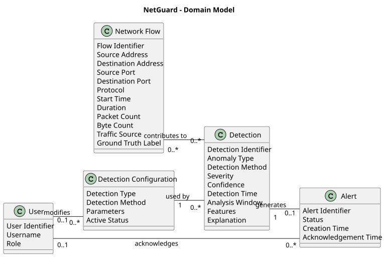

# Domain Model Explanation

## 1. Network Flow

Represents a single normalized network communication flow between a source and a destination. Contains network traffic information used by the detection engine to identify anomalies.

### Attributes

- **Flow Identifier** - Unique identifier of the network flow. (F02, F15)
- **Source Address** - IP address of the device initiating the communication. (F02)
- **Destination Address** - IP address of the receiving device. (F02)
- **Source Port** - Network port used by the source device. (F02)
- **Destination Port** - Network port used by the destination device. (F02)
- **Protocol** - Network protocol used for communication, such as TCP or UDP. (F02)
- **Start Time** - Timestamp indicating when the network flow started. (F02, F03)
- **Duration** - Total duration of the network flow. (F03)
- **Packet Count** - Number of packets transferred during the flow. (F03)
- **Byte Count** - Total amount of data transferred in bytes. (F03)
- **Traffic Source** - Origin of the network flow data, such as PCAP or simulator. (F01)
- **Ground Truth Label** - Known classification of test traffic used to evaluate detection accuracy. (NFR11)

### Related Requirements

**F01 - Data ingestion**
> Import prepared PCAP/flow data, validate input, and report rejected records with the reason.

**F02 - Flow extraction**
> Convert traffic into a normalised flow model.

**F03 - Feature extraction**
> Calculate temporal, volume, and connection-related features.

**F15 - Traceability**
> Allow an event to be traced from input to the generated detection.

**NFR11 - Detection quality**
> Precision, recall, and F1 are measured per anomaly class on a common labelled test set. Initial targets, reviewed after the first measurement in week 5: precision and recall of at least 0.90 for the rule-based classes, macro F1 of at least 0.80, and no HIGH/CRITICAL false alarms on normal traffic.

---

## 2. Detection

Represents an anomaly identified by the detection engine. Stores the classification, detection results, and supporting information explaining why the network activity was considered anomalous.

### Attributes

- **Detection Identifier** - Unique identifier assigned to a detected anomaly. (F08, F15)
- **Anomaly Type** - Classification of the detected anomaly, such as Port Scan, DoS or Brute Force. (F08)
- **Detection Method** - Method used to identify the anomaly, either rule-based or statistical/ML-based. (F06, F07)
- **Severity** - Estimated significance of the anomaly, classified as LOW, MEDIUM, HIGH or CRITICAL. (F08)
- **Confidence** - Numerical score expressing the detection engine's confidence in its result. (F08)
- **Detection Time** - Timestamp indicating when the detection was generated. (F08)
- **Analysis Window** - Time interval of network traffic evaluated to identify the anomaly. (F05)
- **Features** - Measured traffic characteristics supporting the detection, such as connection counts or unique destination ports. (F03, F09)
- **Explanation** - Human-readable description explaining why the anomaly was detected. (F09)

### Related Requirements

**F03 - Feature extraction**
> Calculate temporal, volume, and connection-related features.

**F05 - Time windows**
> Analyse using at least 1 s, 10 s, and 60 s windows.

**F06 - Rule-based detection**
> Detect Port Scan, DoS/DDoS-like Traffic, Brute Force, and Suspicious Connection Pattern using rules and thresholds evaluated in time windows.

**F07 - Second detection method**
> Implement a statistical or ML-based method, e.g. z-score, moving statistics, Isolation Forest, or equivalent. It detects Abnormal Traffic (significant deviation from the historical traffic level) and anomalies that match no known class.

**F08 - Classification**
> Classify each detection as Port Scan, DoS/DDoS-like Traffic, Brute Force, Abnormal Traffic, Suspicious Connection Pattern, or Unknown Anomaly, and store type, severity, confidence, timestamp, source, destination, and detection ID.

**F09 - Explainability**
> Provide evidence and feature values explaining the alert.

**F15 - Traceability**
> Allow an event to be traced from input to the generated detection.

---

## 3. Alert

Represents a notification generated from a detected network anomaly. Allows users to monitor and acknowledge detected threats while maintaining their current status.

### Attributes

- **Alert Identifier** - Unique identifier of the generated alert. (F17)
- **Status** - Current alert state, such as NEW or ACKNOWLEDGED. (F17)
- **Creation Time** - Timestamp indicating when the alert was generated. (F17)
- **Acknowledgement Time** - Timestamp indicating when an operator acknowledged the alert. (F17)

### Related Requirements

**F17 - Alert management**
> Generate alerts from detections and allow the operator to acknowledge an alert; the alert status is stored.

**F13 - Filtering**
> Filter history by at least time, type, severity, and source.

---

## 4. Detection Configuration

Represents settings controlling how the detection engine identifies anomalies. Defines configurable detection rules and parameters that can be modified by administrators.

### Attributes

- **Detection Type** - Type of anomaly that the configuration applies to. (F06, F16)
- **Detection Method** - Detection approach to which the configuration applies, such as rule-based or statistical. (F07, F16)
- **Parameters** - Configurable detection settings, including thresholds, analysis window sizes and statistical parameters. (F05, F16)
- **Active Status** - Indicates whether the configuration is currently enabled. (F16)

### Related Requirements

**F05 - Time windows**
> Analyse using at least 1 s, 10 s, and 60 s windows.

**F10 - Database**
> Persist flows, detections, configuration, and historical data.

**F16 - Detection configuration**
> Thresholds and parameters of the detection methods are configurable; changing them at runtime is an administrative operation.

---

## 5. User

Represents an authenticated user of the NetGuard application. Defines the user's identity and access level, allowing operators to manage alerts and administrators to modify detection settings.

### Attributes

- **User Identifier** - Unique identifier of the application user. (NFR06)
- **Username** - Name used to identify the user within the application. (NFR06)
- **Role** - Defines the user's permissions, such as operator or administrator. (NFR06, F16)

### Related Requirements

**NFR06 - Security**
> The API must provide authentication, authorisation for administrative operations, input validation, and basic API-abuse protection.

**F16 - Detection configuration**
> Thresholds and parameters of the detection methods are configurable; changing them at runtime is an administrative operation.

**F17 - Alert management**
> Generate alerts from detections and allow the operator to acknowledge an alert; the alert status is stored.

---

## 6. Entity Relationships

- **Network Flow - Detection (M:N)** - A network flow may contribute to multiple detections, while a detection may be based on multiple flows. (F09, F15)
- **Detection - Alert (1:0..1)** - A detection may generate one alert for operator review. (F17)
- **Detection Configuration - Detection (1:N)** - Multiple detections may be generated using the same configuration. (F16)
- **User - Alert (1:N)** - A user may acknowledge multiple alerts. (F17)
- **User - Detection Configuration (1:N)** - An administrator may modify multiple detection configurations. (F16)

### Related Requirements

**F09 - Explainability**
> Provide evidence and feature values explaining the alert.

**F15 - Traceability**
> Allow an event to be traced from input to the generated detection.

**F16 - Detection configuration**
> Thresholds and parameters of the detection methods are configurable; changing them at runtime is an administrative operation.

**F17 - Alert management**
> Generate alerts from detections and allow the operator to acknowledge an alert; the alert status is stored.

## 7. Exemplary Data

This section provides example records for each domain entity to illustrate how NetGuard represents network traffic, detections, alerts, configurations, and users.

All records contain fictional data and use simplified identifiers for readability.

### 7.1 Network Flow

| Flow ID | Source Address | Destination Address | Source Port | Destination Port | Protocol | Start Time | Duration | Packet Count | Byte Count | Traffic Source | Ground Truth Label |
|---|---|---|---|---|---|---|---|---|---|---|---|
| F001 | 192.168.1.10 | 192.168.1.20 | 52001 | 21 | TCP | 12:00:01 | 50 ms | 4 | 320 | simulator | port_scan |
| F002 | 192.168.1.10 | 192.168.1.20 | 52002 | 22 | TCP | 12:00:02 | 45 ms | 4 | 300 | simulator | port_scan |
| F003 | 192.168.1.10 | 192.168.1.20 | 52003 | 23 | TCP | 12:00:03 | 55 ms | 5 | 410 | simulator | port_scan |
| F004 | 192.168.1.30 | 192.168.1.40 | 53000 | 443 | TCP | 12:00:04 | 250 ms | 12 | 8400 | simulator | normal |

**Explanation:**

- **F001–F003:** Network flows from the same source to different destination ports, representing part of a simulated port-scanning scenario.
- **F004:** Example of normal HTTPS communication.
- **Ground Truth Label:** Known classification of simulated traffic used only for evaluation, not as input to the detection engine.

### 7.2 Detection

| Detection ID | Anomaly Type | Detection Method | Severity | Confidence | Detection Time | Analysis Window | Features |
|---|---|---|---|---|---|---|---|
| D001 | Port Scan | Rule | HIGH | 0.95 | 12:00:11 | 12:00:00–12:00:10 | unique_dst_ports: 350, threshold: 100 |
| D002 | DoS-like Traffic | Rule | CRITICAL | 1.00 | 12:01:02 | 12:01:00–12:01:01 | connections: 3000, threshold: 500 |
| D003 | Abnormal Traffic | Statistical | MEDIUM | 0.78 | 12:02:05 | 12:01:00–12:02:00 | z_score: 3.8, threshold: 3.0 |

**Explanation:**

- **D001:** The source contacted 350 unique destination ports within 10 seconds, exceeding the configured threshold of 100.
- **D002:** The number of connections to a target exceeded the DoS detection threshold.
- **D003:** The observed traffic deviated from its historical baseline, exceeding the statistical threshold.
- **Features:** Measurements supporting the detection decision.
- **Confidence:** Algorithm-generated confidence score, not necessarily the probability of a real attack.

*Note: D001 represents a larger set of flows than the three example port-scanning records shown in section 7.1.*

### 7.3 Alert

| Alert ID | Related Detection | Status | Creation Time | Acknowledgement Time |
|---|---|---|---|---|
| A001 | D001 | NEW | 12:00:11 | - |
| A002 | D002 | ACKNOWLEDGED | 12:01:02 | 12:03:20 |
| A003 | D003 | NEW | 12:02:05 | - |

**Explanation:**

- **A001:** Alert generated from the port scan detection, awaiting operator acknowledgement.
- **A002:** Alert generated from the DoS detection and acknowledged by an operator.
- **A003:** Alert generated by the statistical detection method, not yet acknowledged.

Acknowledgement confirms operator awareness, not necessarily that the detected issue has been resolved.

### 7.4 Detection Configuration

| Detection Type | Detection Method | Parameters | Active Status |
|---|---|---|---|
| Port Scan | Rule | window_s: 10, unique_dst_ports_threshold: 100 | Active |
| DoS-like Traffic | Rule | window_s: 1, connections_to_target_threshold: 500 | Active |
| Brute Force | Rule | window_s: 60, attempts_same_service_threshold: 50 | Active |
| Abnormal Traffic | Statistical | zscore_threshold: 3.0, min_baseline_windows: 10 | Active |

**Explanation:**

- **Port Scan:** Detects sources contacting a high number of destination ports within a time window.
- **DoS-like Traffic:** Detects excessive connection counts directed at a target.
- **Brute Force:** Detects repeated connection attempts to a service exceeding a configured threshold.
- **Abnormal Traffic:** Identifies deviations from baseline traffic using statistical analysis.

The parameter values are illustrative and follow the default configuration structure in `config/detection.yaml`.

### 7.5 User

| User Identifier | Username | Role |
|---|---|---|
| U001 | admin | USER |
| U002 | operator1 | DEV |
| U003 | operator2 | DEV |

**Explanation:**

- **U001:** Administrator who can change detection configurations and acknowledge alerts.
- **U002:** Operator who can view detections and acknowledge alerts.
- **U003:** Another operator with monitoring and alert acknowledgement permissions.
