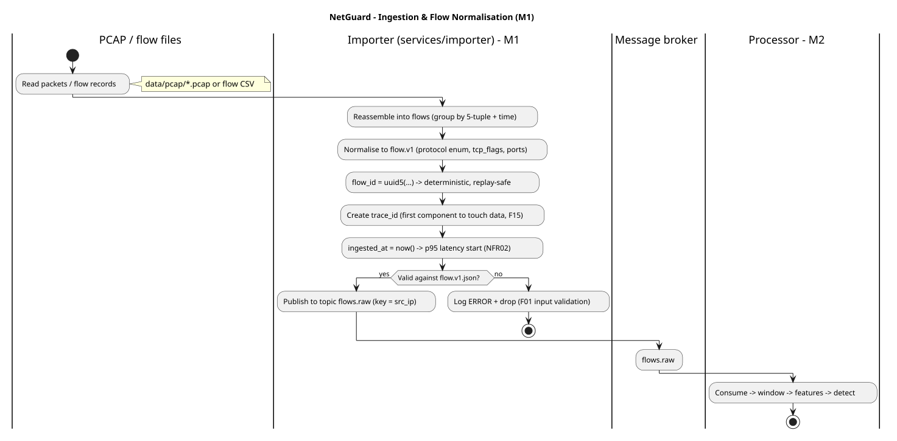

# Architecture Document - Network Data Ingestion & Flow Processing (M1)

> Owner: Valeriia (M1, Network Data & Flow Processing)
> Covers: `services/importer/`, the normalised flow contract (`flow.v1.json`),
> and the ingestion half of the data-flow (spec steps 1-4, F01-F03).

## 1. Responsibility

This component turns prepared input (PCAP captures and flow files) into a stream
of **normalised flows** on the broker topic `flows.raw`. It is the first stage of
the pipeline; everything downstream (windowing, detection, persistence, API,
dashboard) consumes the contract defined here. It does not detect anomalies and
does not touch the database.

The traffic simulator was removed from the requirements in week 3 (Vision v1.2).
Prepared PCAP and flow files are the only data sources. The load generator used
for the performance tests is test tooling owned by M5; it is not part of the product.

## 2. Components

| Component | File | What it does |
|---|---|---|
| Importer | `services/importer/importer.py` | reads a `.csv` or `.pcap` file, normalises and validates every record, publishes to `flows.raw` |
| PCAP reader | `services/importer/pcap_reader.py` | checks the capture, reads packets with `dpkt`, groups them into flows |
| Replay | `services/importer/replay.py` | optional: rebases old timestamps to the present and paces the flows |
| Dataset converter | `services/importer/convert_cic.py` | converts a CIC-IDS2017 labelled CSV into our flow CSV (host tool) |
| Manifest generator | `services/importer/make_manifest.py` | writes the ground-truth manifest of a labelled flow CSV (host tool) |
| Manifest check | `services/importer/check_manifest.py` | checks that a manifest matches its flow CSV (host tool) |

The importer publishes to `flows.raw`, keyed by `src_ip`, so all flows from one
source land on the same partition and are windowed consistently by one processor
instance (see Conventions, section 2). The labelled dataset used for the quality
tests, its conversion and its manifests are described in the dataset section.

## 3. Inputs

| Input | Selected by | `source` | Notes |
|---|---|---|---|
| Flow CSV | `.csv` | `flowfile` | streamed row by row, so the size is not limited by memory |
| Classic Ethernet PCAP | `.pcap`, `.cap` | `pcap` | all flows are kept in memory, files over `MAX_PCAP_MB` (default 200 MB) are refused |

Anything else, including `.pcapng`, is rejected with a clear error. The file name
is given in `FLOW_FILE`.

A flow CSV needs the columns `ts_start`, `duration_ms`, `src_ip`, `dst_ip`,
`src_port`, `dst_port`, `protocol`, `packets`, `bytes`; `tcp_flags` and `label` are
optional. `ts_start` is epoch seconds or an ISO timestamp; `protocol` is a name or an
IP protocol number (1, 6, 17).

## 4. Normalised flow model

Every flow published to `flows.raw` conforms to
`libs/common/src/netguard_common/schemas/flow.v1.json`. The flow fields required by
the spec (the Network Flow Model) map to the schema as follows:

| Required field       | `flow.v1` field | Type / notes                          |
|----------------------|-----------------|---------------------------------------|
| start timestamp      | `ts_start`      | Unix epoch seconds (float)            |
| duration             | `duration_ms`   | milliseconds, >= 0                     |
| source IP            | `src_ip`        | IPv4 or IPv6                          |
| destination IP       | `dst_ip`        | IPv4 or IPv6                          |
| source port          | `src_port`      | 0-65535                               |
| destination port     | `dst_port`      | 0-65535                               |
| protocol             | `protocol`      | enum: TCP / UDP / ICMP / OTHER        |
| packet count         | `packets`       | integer >= 0                          |
| byte count           | `bytes`         | integer >= 0                          |
| TCP flag information | `tcp_flags`     | string (e.g. `SA`), null when not TCP |

Additional schema fields that exist for pipeline correctness, not from the spec:
`schema_version`, `flow_id`, `trace_id`, `ingested_at`, `source` and `label`. The
`label` is ground truth from labelled datasets; it is used **only** for quality
metrics and never read by the detectors.

### 4.1 What one flow means in each input

The two inputs do not define a flow in exactly the same way:

| | PCAP path | flow CSV (CIC-IDS2017) |
|---|---|---|
| direction | unidirectional 5-tuple (source, destination, ports, protocol) | bidirectional: the source is the initiator, both directions are merged |
| `packets`, `bytes` | packets and frame bytes in that direction | forward + backward |
| `tcp_flags` | union of the flags of all packets | union of the flags whose counter is above 0 |
| flow end | none: a 5-tuple that appears again later joins the same flow | decided by the tool that produced the CSV |

The processor treats both the same way. This is a known limitation (section 11).

## 5. Derived features (and where they are computed)

The spec also requires these derived features: packets/sec, bytes/sec, connections
per window, unique destination ports, unique destination addresses, and
new-connection rate. They are **not** stored on the raw flow:

- `packets/sec` and `bytes/sec` are derived per flow
  (`packets / (duration_ms/1000)`) where they are needed.
- `connections per window`, `unique destination ports/addresses` and
  `new-connection rate` are per-source aggregates over a time window. They are
  produced by the processor (M2) in the 1 s / 10 s / 60 s windows (F05), not by the
  importer. This keeps each flow message small and the raw flow a replayable record.

## 6. Normalisation rules

- **Protocol** is mapped to the fixed enum; protocol numbers 1, 6 and 17 become
  ICMP, TCP and UDP; anything else becomes `OTHER`. For ICMP and `OTHER` in the
  PCAP path the ports are 0.
- **`tcp_flags`** is a compact string of set flags (`F S R P A U E C`); `null` when
  the flow is not TCP or the flags are unknown.
- **Timestamps** are epoch seconds or ISO text and are stored as epoch seconds.
- **`label`**: the allowed values are read from `flow.v1.json`, so the importer
  cannot drift from the schema; `benign` is written as `normal`; empty means no label.
- **`flow_id`** is a deterministic UUID (uuid5) over the **file name and the record
  position** (`flow_id_for(file, index)`). Importing the same file again gives the
  same IDs, so the idempotent writes do not create duplicates (IT-05). Two different
  files with the same name would collide, so a different slice needs a different name.
- **`source`** records where the flow came from (`pcap` or `flowfile`).

## 7. Input validation and error reporting (F01, SEC-02)

There are two levels:

1. **A record** is checked against `flow.v1.json` before publishing. An invalid
   record is rejected with its reason: logged at ERROR, sent to `flows.deadletter`
   and never published, so one bad record cannot stop the pipeline (issue #8).
2. **The file as a whole** can be unusable: unsupported type, not a pcap (bad magic
   number), pcapng, a link type other than Ethernet, a CSV without the needed
   columns or not readable as text, a PCAP over the size limit, a missing file. The
   importer reports the reason and exits with code 1. A **truncated** capture is not
   an error: only the complete packet records are imported and a warning is added.

Whatever happens, the importer prints one summary line at the end:

```
[importer] accepted=125 rejected=0 reasons={} warnings=[] error=None
```

## 8. Trace ID and latency (F15, NFR02)

The importer is the **first component to touch the data**, so it:

- creates the `trace_id` (`new_trace_id()` from `netguard_common`) that every
  downstream message and log line carries (F15, NFR08);
- sets `ingested_at` when it accepts the flow and never overwrites it. This is the
  start point of the ingestion-to-detection latency (NFR02). In replay mode it is set
  after the wait, so the latency does not include the pacing.

## 9. Old timestamps and replay mode (risk R12)

A dataset such as CIC-IDS2017 has timestamps from 2017, while time windows in a live
system could follow the clock. Two things handle this:

- **The processor.** The windows of the detection engine
  (`services/processor/detection_engine/windows.py`) run on an event clock per
  source: the newest `ts_start` seen for it, moved forward by the wall-clock time
  since its last flow. Old timestamps therefore work without any replay: a Friday
  PortScan slice of 55,320 flows with 2017 timestamps was processed with 4 late
  flows. The clock of a source stays at the time of the last import, so the processor
  must be restarted before a dataset from a different time is imported, otherwise
  its flows are counted as late.
- **Replay mode (`REPLAY_SPEED`).** The importer can rebase `ts_start` to the
  present and sleep between flows, so the data arrives like live traffic:

| Variable | Meaning |
|---|---|
| `REPLAY_SPEED` | 1 keeps real time; a higher value divides every gap by it; unset = replay off |
| `REPLAY_MAX_GAP_S` | caps idle gaps (seconds of the original data) |

At speed 1 the rates are the real ones, so the detection thresholds apply as they
are. At a higher speed all rates are multiplied by the speed; use it for quick
checks only. Flows that arrive out of order get the time of the previous flow.
For quality measurements the data is imported **without** replay, so the detections
carry the same flow time as the ground-truth manifest.

## 10. Delivery semantics

Delivery is at-least-once. Because `flow_id` is deterministic and downstream writes
are idempotent (`ON CONFLICT DO NOTHING`), a redelivered flow does not create
duplicate rows or duplicate detections.

## 11. Known limitations

- The PCAP path keeps every flow in memory and has no flow timeout; it is for small
  captures. Large datasets go in as flow CSV.
- PCAP flows are unidirectional and CIC flows are bidirectional (section 4.1).
- `.pcapng`, non-Ethernet captures and fragmented packets are not supported.
- `flow_id` depends on the file name and the position, not on the content.
- Every rejected record is logged at ERROR; a file with many invalid records produces
  many log lines.
- The dataset converter holds one day's file in memory (it sorts by time).
- Replay at a speed above 1 changes the rates (section 9).

## 12. Data-flow diagram



Source: [`diagrams/ingestion_dataflow.puml`](diagrams/ingestion_dataflow.puml)

## 13. Tests

| File | What it covers |
|---|---|
| `tests/unit/test_importer.py` | normalisation, flow schema, deterministic `flow_id`, rejected rows |
| `tests/unit/test_importer_robustness.py` | wrong, broken and truncated files, pcapng, labels from the schema (SEC-02) |
| `tests/unit/test_pcap_reader.py` | flow grouping and flag accumulation (UT-11) |
| `tests/unit/test_convert_cic.py` | dataset conversion: labels, timestamps, flags, time slice |
| `tests/unit/test_replay.py` | replay pacing and timestamp rebasing |
| `tests/unit/test_make_manifest.py` | episodes and manifest validation |
| `tests/unit/test_check_manifest.py` | consistency of a manifest with its CSV |

The integration tests of the import (IT-03, IT-05) are in the test plan.

## 14. How to run

```
# import a file (the stack must be up: docker compose up -d redpanda processor)
docker compose --profile import run --rm -e FLOW_FILE=/app/data/pcap/sample.pcap importer
docker compose --profile import run --rm -e FLOW_FILE=/app/data/flows/sample.csv importer

# replay a dataset in real time
docker compose --profile import run --rm -e FLOW_FILE=/app/data/flows/<file>.csv -e REPLAY_SPEED=1 importer

# convert a CIC-IDS2017 file, write its manifest and check it (on the host)
python3 services/importer/convert_cic.py data/raw/<file>.csv data/flows/<name>.csv --spread-minutes
python3 services/importer/make_manifest.py data/flows/<name>.csv
python3 services/importer/check_manifest.py data/flows/<name>.csv
```
