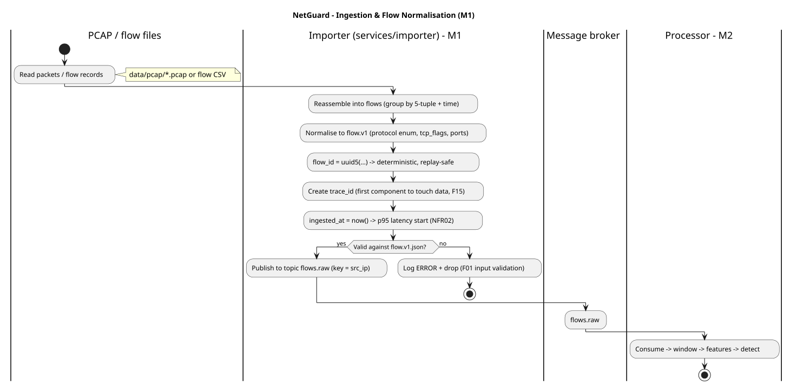

# Architecture Document — Network Data Ingestion & Flow Processing (M1)

> Owner: Valeriia (M1 — Network Data & Flow Processing)
> Covers: `services/importer/`, the normalised flow contract (`flow.v1.json`),
> and the ingestion half of the data-flow (spec steps 1–4, F01–F03).

## 1. Responsibility

This component turns raw input — prepared PCAP/flow files or synthetic traffic
from the simulator — into a stream of **normalised flows** on the broker topic
`flows.raw`. It is the first stage of the pipeline; everything downstream
(windowing, detection, persistence, API, dashboard) consumes the contract
defined here. It does not detect anomalies and does not touch the database.

## 2. Components

- **Importer (`services/importer/`, M1):** reads a PCAP or flow file, reassembles
  packets into flows, normalises each flow to the `flow.v1` schema, validates it,
  and publishes it to `flows.raw`.
- **Simulator (`services/simulator/`, M1):** produces the same `flow.v1` messages
  for normal traffic and the required anomalous scenarios, so the pipeline can run
  without any real network.
- **Boundary out:** both publish to `flows.raw`, keyed by `src_ip`, so all flows
  from one source land on the same partition and are windowed consistently by one
  processor instance (see Conventions §2).

## 3. Normalised flow model

Every flow published to `flows.raw` conforms to
`libs/common/src/netguard_common/schemas/flow.v1.json`. The flow fields required by the spec (the Network Flow Model) map to the schema as follows:

| Required field       | `flow.v1` field | Type / notes                          |
|----------------------|-----------------|---------------------------------------|
| start timestamp      | `ts_start`      | Unix epoch seconds (float)            |
| duration             | `duration_ms`   | milliseconds, ≥ 0                      |
| source IP            | `src_ip`        | IPv4 or IPv6                          |
| destination IP       | `dst_ip`        | IPv4 or IPv6                          |
| source port          | `src_port`      | 0–65535                               |
| destination port     | `dst_port`      | 0–65535                               |
| protocol             | `protocol`      | enum: TCP / UDP / ICMP / OTHER        |
| packet count         | `packets`       | integer ≥ 0                           |
| byte count           | `bytes`         | integer ≥ 0                           |
| TCP flag information  | `tcp_flags`     | string (e.g. `SA`), null when not TCP |

Additional schema fields that exist for pipeline correctness, not from Spec §8:
`schema_version`, `flow_id`, `trace_id`, `ingested_at`, `source`
(pcap/flowfile/simulator), and `label` (ground truth from the simulator /
labelled datasets, used **only** for quality metrics, never read by detectors).

## 4. Derived features (and where they are computed)

The spec also requires these derived features: packets/sec, bytes/sec, connections per window, unique
destination ports, unique destination addresses, and new-connection rate.

These are **not** stored on the raw flow:

- `packets/sec` and `bytes/sec` are trivially derived per flow
  (`packets / (duration_ms/1000)`), and may be recomputed where needed.
- `connections per window`, `unique destination ports/addresses`, and
  `new-connection rate` are **per-source aggregates over a time window**. They are
  produced by the Processor (M2) across the 1 s / 10 s / 60 s windows (F05), not by
  the importer. Keeping them out of `flow.v1` keeps each flow message small and
  makes the raw flow a pure, replayable record.

## 5. Normalisation rules

- **Protocol** is mapped to the fixed enum; anything that is not TCP/UDP/ICMP
  becomes `OTHER`.
- **`tcp_flags`** is a compact string of set flags (`F S R P A U E C`); `null` when
  the flow is not TCP or flags are unknown.
- **`flow_id`** is a deterministic UUID (uuid5) over the flow's identity
  (5-tuple + `ts_start` + source). This means re-importing the same file produces
  the same IDs, so replays deduplicate instead of creating duplicates.
- **`source`** records where the flow came from (pcap / flowfile / simulator).

## 6. Input validation (F01, SEC-02)

Every normalised flow is validated against `flow.v1.json` before publishing.
A malformed or incomplete record is **rejected with its reason** — logged at
ERROR and dropped, never published — so one bad record cannot stop the pipeline
(issue #8). At the end of a run the importer prints a short summary: how many
records were accepted, how many were rejected, and the reason counts. This
satisfies F01 (report rejected records with the reason) and is what SEC-02 in
the test plan checks.

## 7. Trace ID and latency (F15, NFR02)

The importer/simulator is the **first component to touch the data**, so it:

- creates the `trace_id` that every downstream message and log line carries,
  enabling an event to be traced end to end (F15, NFR08);
- sets `ingested_at` once (never overwritten). This is the start point for the
  p95 ingestion-to-detection latency measurement (NFR02).

## 8. Delivery semantics

Delivery is at-least-once. Because `flow_id` is deterministic and downstream
writes are idempotent (`ON CONFLICT DO NOTHING`), a redelivered flow does not
create duplicate rows or duplicate detections.

## 9. Data-flow diagram

Source: [`diagrams/ingestion_dataflow.puml`](diagrams/ingestion_dataflow.puml)

## 10. Week-3 plan (implementation)

- Build `services/importer/` to read PCAP (e.g. via a packet library) and flow
  files, apply §5 normalisation, validate (§6), and publish to `flows.raw`.
- Unit tests for normalisation and validation; mark tests that cover test-plan IDs
  in their docstrings (Conventions §9).