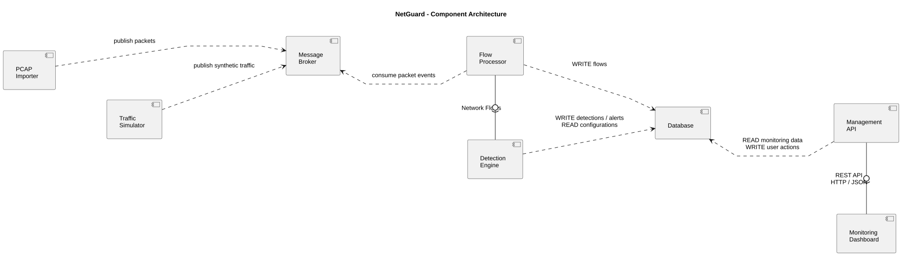

# NetGuard - Component Architecture

The system consists of independent components that communicate through a message broker, shared database storage
and a REST API. The diagram shows the pipeline as it runs: the importer publishes normalised flows, the processor
publishes detections, and only the persister writes them to the database. The
[system overview](../../README.md#architecture) shows the same pipeline with the broker topics as interfaces.

## Components

- **PCAP Importer** - Reads PCAP and flow files, turns packets into normalised flows and publishes them to the
  `flows.raw` topic (key: source IP).
- **Message Broker** - Redpanda (Kafka API) with the topics `flows.raw` and `detections`. Consumer groups let the
  processor run as several instances.
- **Flow Processor** - Consumes `flows.raw` and keeps the per-source time windows (1 s, 10 s, 60 s) and their
  features.
- **Detection Engine** - Part of the processor service. Applies the rules and the statistical method to the window
  features, classifies the anomaly and publishes the detection with its evidence to `detections`. Thresholds come
  from `config/detection.yaml`; changing them at runtime through the API is planned (F16).
- **Persister** - Consumes `flows.raw` and `detections` and writes flows and detections to the database in batches.
  It is the only component that writes pipeline data to the database.
- **Database** - TimescaleDB. Stores flows, detections, alerts, configurations and user data.
- **Management API** - REST API under `/api/v1`: authentication, flows, detections, alerts, statistics and detection
  configurations.
- **Monitoring Dashboard** - Lets operators monitor network activity, inspect alerts and manage detection settings
  through the Management API.
