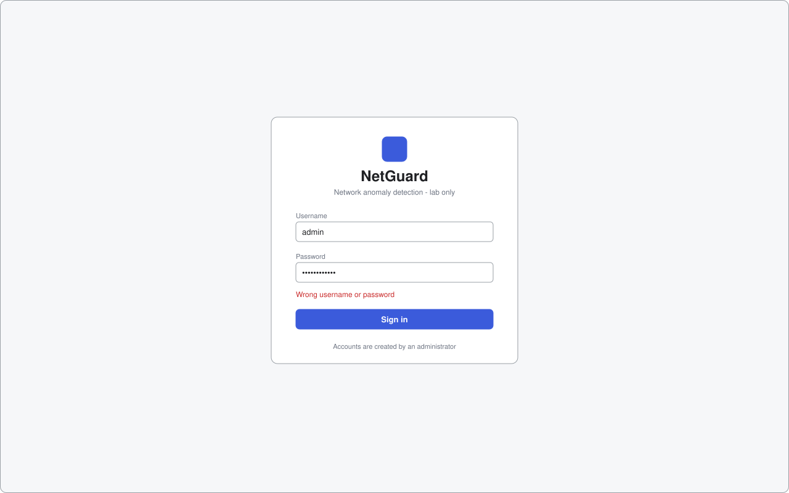
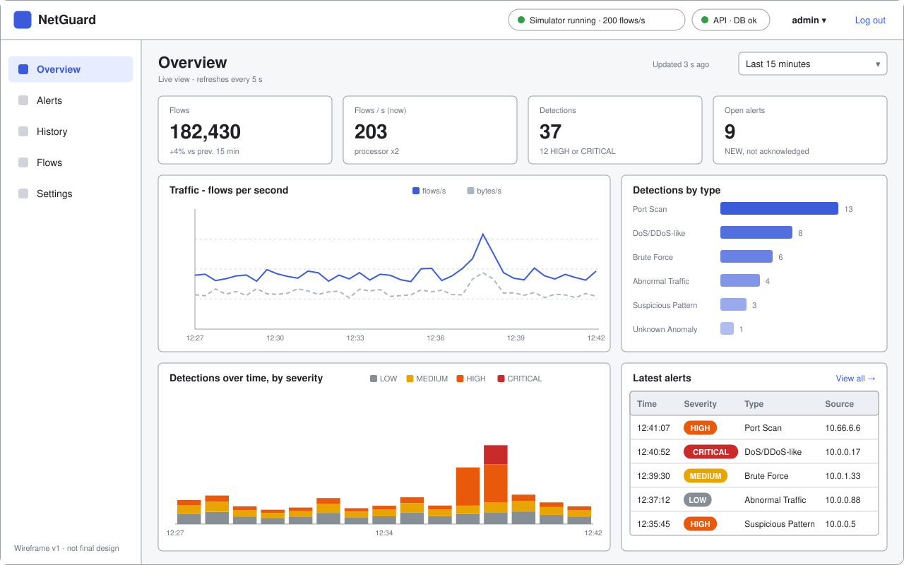
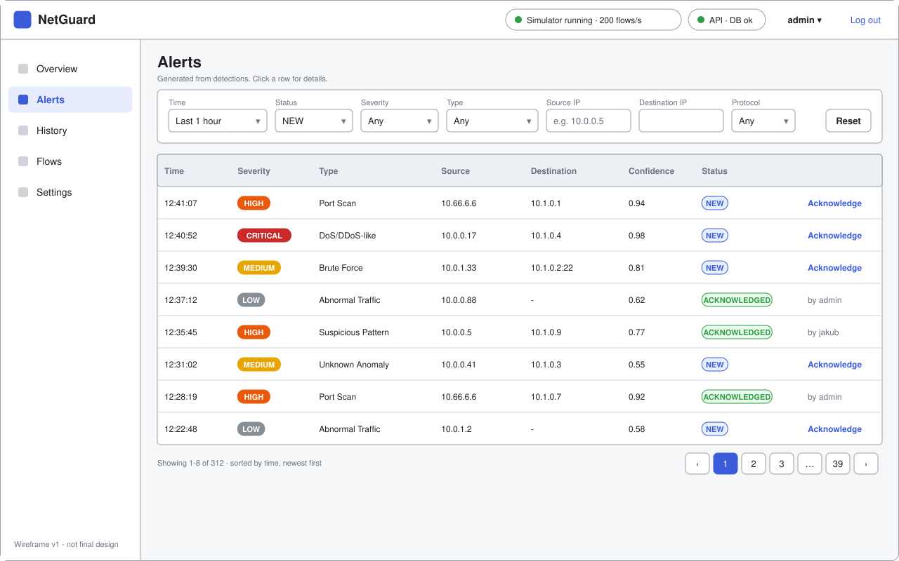
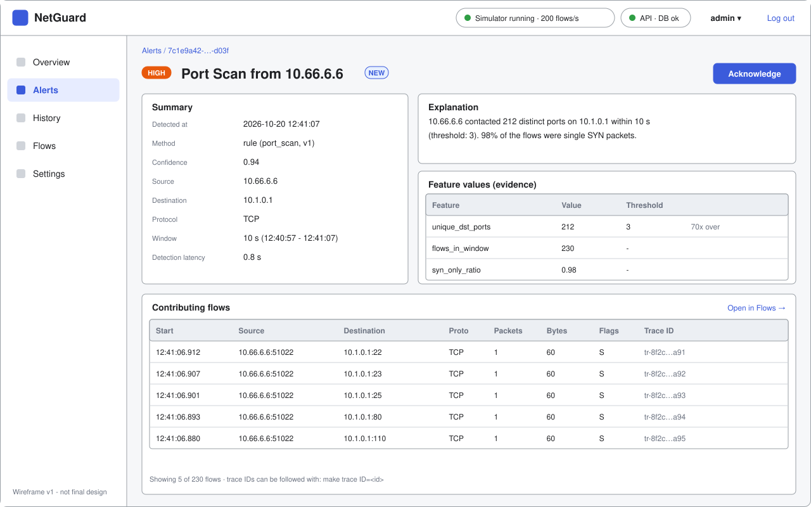
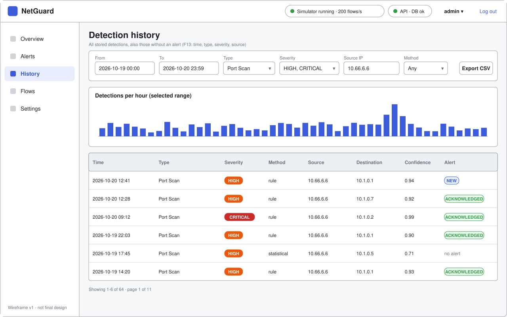
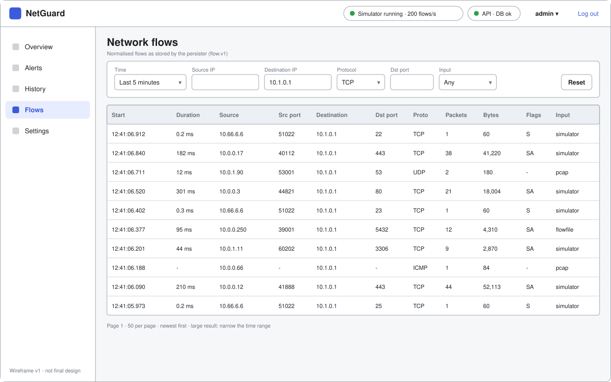
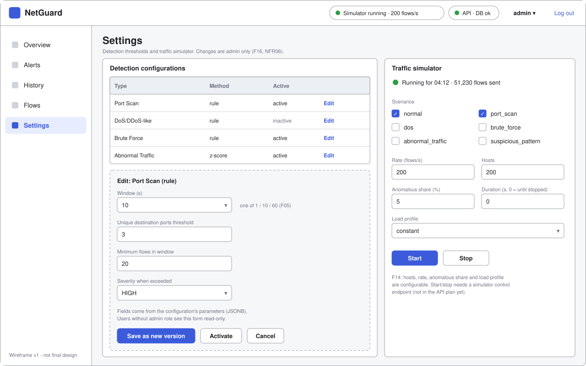
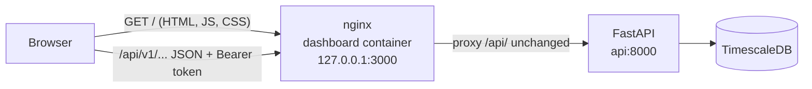
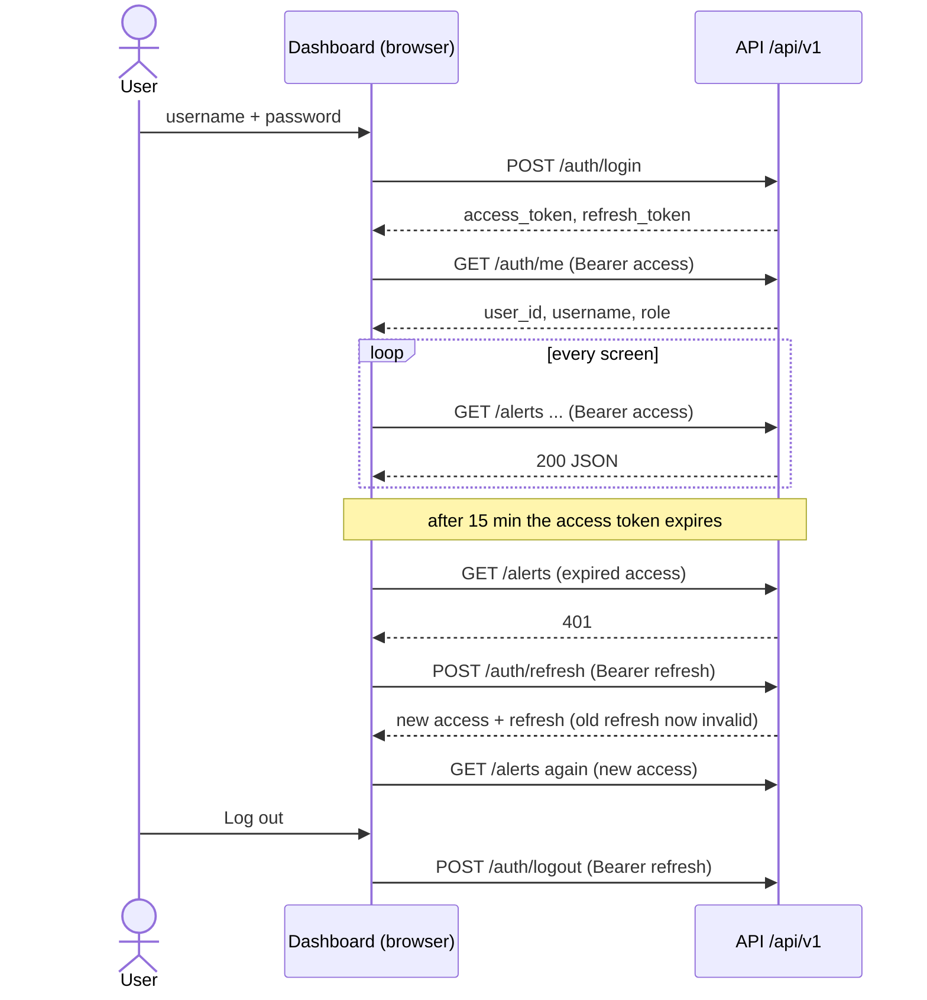

# Architecture Document - Monitoring Dashboard (M4)

> Owner: Daniyar (M4, Frontend & Visualization)
> Covers: `services/dashboard/`, the screens of the web UI, how the UI gets its data from the REST API,
> login, and what the UI still needs from the API (F12, F13, F16, F17, UC-02 to UC-13).

## 1. Responsibility

The dashboard is the only part of NetGuard a user sees. It shows live traffic statistics, trend charts, alerts and
detection details with their evidence, the stored history, flows, and lets an administrator change detection
thresholds and start or stop the traffic simulator.

It is a static single-page application (SPA). It has no database and no business logic of its own: every number on
the screen comes from the REST API (`services/api`, M3). It never talks to the broker or the database directly.

## 2. Screens

Wireframes are in [`wireframes/`](wireframes/). They are low fidelity: layout and content, not the final look.

| # | Screen | Shows | Requirements | API it uses |
|---|---|---|---|---|
| 1 | Login | username + password form | NFR06 | `POST /auth/login` |
| 2 | Overview | stat cards (flows, flows/s, detections, open alerts), traffic trend, detections over time by severity, detections by type, latest alerts | F12, UC-06 | `GET /dashboard/summary`, time-series (missing, see 6.1), `GET /alerts` |
| 3 | Alerts | alert list with filters (time, status, severity, type, source/destination IP, protocol), paging, acknowledge | F13, F17, UC-02, UC-05, UC-09 | `GET /alerts`, `PATCH /alerts/{id}/acknowledge` |
| 4 | Alert details | type, severity, status, confidence, window, explanation, feature values, contributing flows, trace IDs | F09, F15, UC-03 | `GET /alerts/{id}`, `GET /detections/{id}/flows` |
| 5 | History | all stored detections (also the ones without an alert), filters, detections-per-hour chart | F13, UC-04 | `GET /detections` with filters (missing, see 6.1) |
| 6 | Flows | normalised flows with filters and paging | F11, UC-08 | `GET /flows`, `GET /flows/{flowId}` |
| 7 | Settings | detection configurations (edit and activate, admin only), simulator start/stop with its parameters | F14, F16, UC-07, UC-10 to UC-13 | `/detection-configurations`, simulator control (missing, see 6.1) |

All API paths in this document are relative to `/api/v1`.

Every screen except Login has the same frame: top bar with the simulator status, API/DB health and the user menu,
and a side menu with the five pages. Users without the admin role see Settings read-only; the API enforces this
anyway, the UI only hides buttons that would fail.

| | |
|---|---|
|  |  |
|  |  |
|  |  |
|  | |

## 3. Technology

| Concern | Choice | Why |
|---|---|---|
| UI framework | React 19 + TypeScript | Required by the team plan. TypeScript lets us write the API response types once and catch contract changes at build time. |
| Build tool | Vite | Fast dev server with a proxy to the API, produces plain static files for nginx. |
| Routing | React Router | One URL per screen, so alert details can be linked and bookmarked (`/alerts/<id>`). |
| Server data | TanStack Query | Polling (`refetchInterval`), caching, retries, pauses when the browser tab is hidden. Replaces a lot of hand-written `useEffect` code. |
| Charts | Recharts | See 3.1. |
| Styling | Plain CSS with CSS variables | No UI kit: small bundle, nothing to learn, enough for tables, forms and cards. |
| Tests | Vitest + React Testing Library | Component tests (test plan section 8, M4). Same config as Vite. |
| End-to-end | Playwright | ST-02 to ST-05 and SEC-08 together with M5 in week 7 (issue #14). |

### 3.1 Chart library: Recharts

We need line/area charts over time, stacked bars by severity and horizontal bars by type, with tooltips and legends.
The API returns pre-aggregated buckets, so one chart has at most a few hundred points.

| Option | For | Against |
|---|---|---|
| **Recharts** (chosen) | Charts are normal React components, so they re-render from the same query data as the tables. SVG output: sharp, easy to test, text is escaped. Has every chart type we need. | Slower than canvas with tens of thousands of points, which we never draw (the API aggregates). |
| Chart.js | Fast canvas rendering, popular | Imperative API; needs a React wrapper; canvas content is not visible to component tests. |
| Apache ECharts | Very powerful, fast | Large bundle, many features we don't need. |
| D3 | Full control | Low level; every axis and tooltip by hand; too slow to build in our timeline. |
| Grafana | Ready-made dashboards | A separate tool, not our application; no alert acknowledge or simulator control; the spec asks for our own dashboard. |

## 4. How the dashboard gets its data

### 4.1 Deployment and request path



- The React app is built in a multi-stage Docker image (`node` stage runs `npm ci && npm run build`, the `nginx`
  stage serves `dist/`). `docker compose up -d --build` keeps working as the one start command (NFR05).
- nginx serves the static files and proxies `/api/` to the API container **without changing the path**, so the
  browser calls `/api/v1/alerts` and the API receives `/api/v1/alerts`. The API health check is exposed as
  `/api/health`. Same origin for UI and API: no CORS configuration needed.
- Unknown paths fall back to `index.html` (`try_files`), so a page reload on `/alerts/<id>` works.
- nginx adds security headers: a Content-Security-Policy that only allows our own scripts, `X-Content-Type-Options`,
  `Referrer-Policy`.
- During development `npm run dev` starts Vite on port 5173 and proxies `/api` to `http://localhost:8000`, so the UI
  can be developed against the normal compose stack with hot reload.

### 4.2 Polling, not WebSockets (for now)

All data is fetched with REST calls. Screens that show live data refetch on a timer:

| Screen | Refresh |
|---|---|
| Overview (cards, charts, latest alerts) | every 5 s |
| Alerts list | every 5 s |
| Alert details | every 10 s (status may be changed by another user) |
| Top bar (health, simulator status) | every 10 s |
| History, Flows, Settings | on load and when filters change, plus a manual refresh button |

Polling stops while the browser tab is hidden and restarts with an immediate refetch when it becomes visible again
(TanStack Query default). After an acknowledge, the alert queries are invalidated, so the change shows at once.

Why not WebSockets or Server-Sent Events now:

- Nothing pushes data to the API: the persister writes to the database and the API only reads it. A push channel
  would need a new source (Postgres `LISTEN/NOTIFY` or a consumer of the `detections` topic inside the API).
- It needs authentication on a long-lived connection, nginx upgrade settings and reconnect logic.
- A 5 s delay is fine for a human operator. Detection itself (NFR02) is measured in the pipeline, not in the UI.
- The backend integration plan already lists real-time updates as out of MVP scope.

If there is time after week 7, an SSE endpoint `GET /stream/alerts` can replace the 5 s polling of the alert list;
the screens would not change.

Load: one open dashboard makes about 4 requests per 5 s. The k6 API load test (PT-05) polls the alert list every
2 s per virtual user, which is more than the dashboard does, so it is a safe upper bound.

### 4.3 Time ranges

The user picks a range (last 5 min / 15 min / 1 h / 24 h or custom from-to). The UI sends `start_time` and
`end_time` as ISO 8601 in UTC (`2026-10-20T12:00:00Z`), which the summary and alert endpoints require.
Times are shown in the browser's local time zone.

## 5. Login and tokens

Authentication is Jakub's JWT module (`/auth/*`, see [Authentication](../../BackendAndDataStorage/auth/README.md)):
access token valid for 15 min, refresh token for 7 days, refresh rotates the pair, tokens are sent in the
`Authorization: Bearer` header.



Rules in the UI:

- The **access token is kept in memory only**. The **refresh token is kept in `sessionStorage`**, so a page reload
  does not log the user out, and closing the tab does.
- On a `401` the API client calls `/auth/refresh` **once** and repeats the request. Several requests that fail at the
  same time share one refresh call; this matters because refresh rotates the token, and a second parallel refresh
  with the old token would get `401` and log the user out.
- If refresh fails, the UI clears the tokens and shows the login page with "session expired".
- The role from `/auth/me` decides which buttons are shown (admin: edit configuration, start/stop simulator).
  This is only convenience: the API checks the role on every request (NFR06).
- No self-registration in the UI: accounts are created by an administrator (`POST /auth/register`).
  The first administrator is created with `docker compose exec api python -m app.infrastructure.bootstrap_admin`.

Known limitation: a refresh token in `sessionStorage` can be read by an XSS bug. We reduce that risk with React's
escaping (we never use `dangerouslySetInnerHTML`, SEC-08) and the CSP header. An `HttpOnly` cookie for the refresh
token would be safer but needs API changes; we can revisit it in week 8.

## 6. API review from the UI side

I checked the [backend integration plan](../../Architecture/Backend_Data_Storage/integration.md), the
[endpoint list](../../BackendAndDataStorage/endpoints.md) and the current code in `services/api` against the screens
in section 2.

| Screen | Endpoints | Enough? |
|---|---|---|
| Login, user menu | `/auth/login`, `/auth/refresh`, `/auth/logout`, `/auth/me` | Yes. |
| Overview, cards | `GET /dashboard/summary` | Mostly. Missing: open alerts (status NEW) and counts by type and severity (6.1, G2). |
| Overview, charts | none | **No.** Trend charts need a time-series endpoint (6.1, G1). |
| Alerts list | `GET /alerts` | Filters and paging are good. Items lack the detection fields shown in the table (G3). |
| Alert details | `GET /alerts/{id}`, `PATCH /alerts/{id}/acknowledge` | Yes for the summary and explanation. Evidence flows need `GET /detections/{id}/flows` (G6). |
| History | `GET /detections` | **No.** Only `limit`, no filters, no paging (G5). |
| Flows | `GET /flows`, `GET /flows/{flowId}` (planned) | Yes if filters match section 2 (G7). |
| Settings, thresholds | `/detection-configurations` (planned) | Yes, details on the form in G8. |
| Settings, simulator | none | **No.** Simulator control is required by F11/F14 and API-06 (G9). |
| Top bar | `GET /health` | Yes. Simulator status needs G9. |

### 6.1 Gaps and proposals

**G1 - Time-series endpoint for the trend charts (needed for F12, ST-05).**

```http
GET /api/v1/dashboard/timeseries?start_time=2026-10-20T12:00:00Z&end_time=2026-10-20T12:15:00Z&interval_s=60
```

```json
{
  "interval_s": 60,
  "points": [
    {
      "ts": "2026-10-20T12:00:00Z",
      "flows": 12034,
      "packets": 401223,
      "bytes": 88123456,
      "detections": {"LOW": 1, "MEDIUM": 0, "HIGH": 2, "CRITICAL": 0}
    }
  ]
}
```

- Buckets with TimescaleDB `time_bucket` on `network_flows.ts_start` and `detections.created_at`.
- Empty buckets returned as zeros (`time_bucket_gapfill`), otherwise the line chart draws a straight line across gaps.
- Limit the number of points (for example at most 500) and return 422 if `interval_s` is too small for the range.
  The UI picks the interval: 5 s for 5 min, 15 s for 15 min, 1 min for 1 h, 15 min for 24 h.
- Flows per second for the "Flows/s" card = `flows / interval_s` of the last full bucket, so no extra endpoint.

**G2 - More numbers in the summary.** Add to `GET /dashboard/summary`: `open_alert_count` (status NEW),
`detections_by_type` and `detections_by_severity` (objects `{type: count}`) for the same range. One extra
`GROUP BY` each; avoids three more requests every 5 s.

**G3 - Detection fields in the alert list.** `GET /alerts` items only have `alert_id`, `detection_id`, `status`,
`created_at`, `acknowledged_at`. The table shows type, severity, confidence, source, destination, so the UI would need
one extra request per row. Proposal: add a short `detection` object to each item (`type`, `severity`, `confidence`,
`src_ip`, `dst_ip`, `protocol`), the same join the filters already use. Nice to have: `acknowledged_by` (username),
the ERD has the Users - Alerts relation but the `alerts` table has no column for it yet.

**G4 - Nothing creates alerts yet.** The persister inserts detections but never inserts into `alerts`, so the alert
screens stay empty on a running stack. We need a decision (M2 + M3): one alert per detection, or only for severity
MEDIUM and higher? Same `ON CONFLICT` idempotency as for detections.

**G5 - Detection history with filters (F13, UC-04, API-03).** `GET /detections` should take the same parameters and
return the same page shape as `GET /alerts`: `start_time`, `end_time`, `type`, `severity`, `method`, `src_ip`,
`dst_ip`, `page`, `page_size` -> `{items, total, page, page_size}`. Each item ideally carries `alert_id` and
`alert_status` (null when there is no alert). For the Overview the existing "latest N" behaviour is still useful
(page 1, newest first). It needs the user/admin role check once the dashboard has login (the code comment already
says so); the placeholder page and IT-02 currently call it without a token, so this change goes together with the
React app replacing the placeholder.

**G6 - Evidence flows for a detection.** `GET /detections/{id}/flows` is planned, but `db/init/001_schema.sql` has no
`detection_flows` table (the ERD has one). Detections carry `trace_ids` (a sample), and `network_flows` has an index on
`trace_id`, so the endpoint could return the flows whose `trace_id` is in the detection's `trace_ids`. Paged, newest
first. Please confirm which way you want it.

**G7 - Flow list filters.** `GET /flows`: `start_time` + `end_time` (required, to keep queries on the hypertable small),
`src_ip`, `dst_ip`, `protocol`, `dst_port`, `source`, `page_size`. A `total` count over millions of flows is expensive;
`has_more` (or a cursor on `ts_start`) is enough for the UI.

**G8 - Detection configuration form.** `parameters` is free JSONB, so the UI shows one input per key with its current
value (numbers as number fields). Please document the `PATCH` body (whole `parameters` object or one key?) and return
422 with the field name for invalid values, so the form can show the error next to the field. Writes admin only.

**G9 - Simulator control (F11, F14, UC-10 to UC-13, API-06).** Not in the endpoint plan. Proposal:

| Method | Path | Body / result |
|---|---|---|
| GET | `/simulator` | `{running, started_at, flows_sent, config}` |
| POST | `/simulator/start` | `{scenarios, rate, hosts, anomaly_share, duration_s, profile}` (admin) |
| POST | `/simulator/stop` | (admin) |

Today the simulator is a one-shot `docker compose run` container, so the API cannot start it. This needs a short design
with Valeriia (M1) and Vlad (M5): for example the simulator runs as a normal service waiting for commands on a
`simulator.control` topic and publishes its status, and the API publishes start/stop commands.

**G10 - System metrics (F11, "system metrics").** Nice to have for the Overview: processor instances, consumer lag,
p95 detection latency (`detection_latency` view). Can come later.

**Other notes for the API:**

- Rate limiting (NFR06, SEC-07): one dashboard tab makes about 4 requests per 5 s; the limit should allow a few
  tabs per user.
- Keep error bodies as they are now (`{"detail": ...}`), the UI shows `detail` when it is a string and maps
  validation errors to form fields.

## 7. Code structure

```
services/dashboard/
  Dockerfile            multi-stage: node build -> nginx
  nginx.conf            static files, /api proxy, SPA fallback, security headers
  package.json
  vite.config.ts        dev proxy /api -> localhost:8000, Vitest config
  src/
    main.tsx            React root, QueryClient, Router
    App.tsx             routes and the shared layout
    api/                fetch client (tokens, refresh, errors) + one file per resource with its types
    auth/               AuthProvider, login page, route guard
    components/         Layout, StatCard, SeverityBadge, tables, charts
    pages/              Overview, Alerts, AlertDetails, History, Flows, Settings
    lib/                time ranges and formatting helpers
```

Rules: API types in `src/api/` mirror the Pydantic responses; components never call `fetch` directly; all text from
the API is rendered as text (no HTML), which is what SEC-08 checks.

## 8. Testing

- **Component tests** (Vitest + Testing Library, `npm test`): API client refresh logic, login form, severity badge,
  alert table rendering, filter to query-string mapping, time-range helpers. Run in CI next to the Python tests.
- **End-to-end** (Playwright, week 7 with M5, issue #14): ST-02 simulator scenario visible on the dashboard,
  ST-03 PCAP import visible, ST-04 history filters, ST-05 live statistics and charts update, SEC-08 HTML in a detection
  field shown as text.
- **Security**: `npm audit` in the week 9 scans (issue #17), ZAP baseline against the dashboard (SEC-12).

## 9. Plan

| Week | Dashboard work |
|---|---|
| 2 (late) | this section, wireframes, API review (this PR) |
| 3 | React app in `services/dashboard`, Docker build into nginx, routing and layout, login + API client |
| 4 | Overview with cards and charts (mid-term presentation: wireframes + running skeleton) |
| 5 | Alerts list with filters, alert details with evidence, acknowledge |
| 6 | History and Flows screens, detections endpoint behind login |
| 7 | Settings (thresholds, simulator), Playwright end-to-end tests with M5 |
| 8 | Loading/error/empty states, accessibility, check under API load (PT-05) |
| 9-10 | `npm audit`, screenshots for the test report and the demo, bug fixes |

## 10. Open questions

- G4: who creates alerts and for which severities (M2, M3)?
- G9: simulator control design (M1, M3, M5).
- UC-01 "Import PCAP files" is listed for the End User. The importer (M1) is a command-line tool for now; uploading a
  PCAP from the dashboard is not planned unless we decide otherwise.
