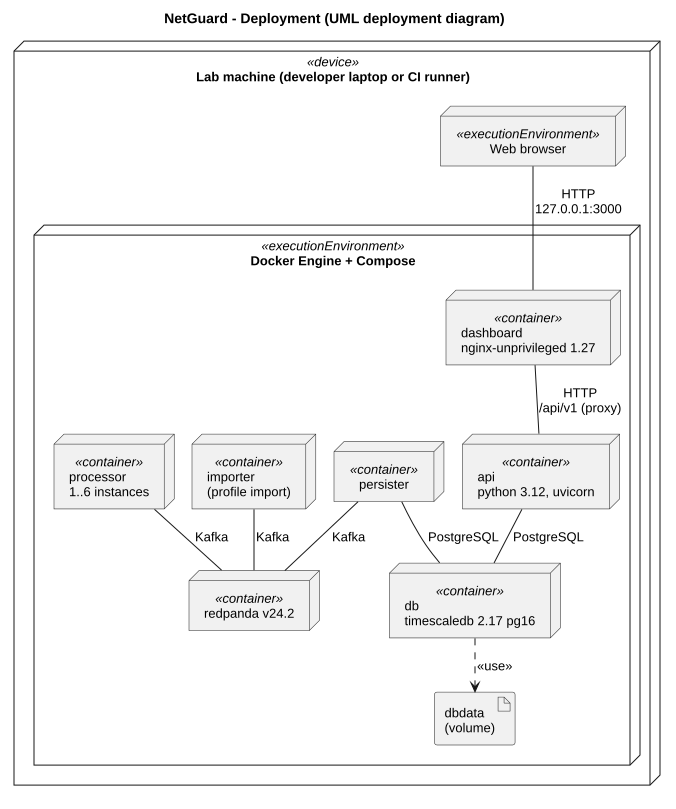

# Architecture Document - Deployment, CI/CD and Testing (M5)

> Owner: Vlad (M5, Infrastructure, Testing & DevOps)
> Covers: `docker-compose.yml`, `services/python.Dockerfile`, `.github/workflows/ci.yml`, the test environments and
> the ground-truth format for the detection quality tests.

## 1. Responsibility

This part describes how NetGuard is packaged, started, scaled and tested. The whole platform runs on one machine with
one documented command (NFR05), everything stays on that machine (NFR09), and every pull request is tested on the
full stack before it can be merged. What we test and when is in the [test plan](../../TestPlan/README.md); this
section is about the infrastructure that makes it possible.

## 2. Deployment view



Source: [`diagrams/deployment.puml`](diagrams/deployment.puml)

| Container | Image / build | Host port | Health check | Waits for | Restart |
|---|---|---|---|---|---|
| `redpanda` | `redpandadata/redpanda:v24.2.7`, dev-container mode, 1 core, 1 GB | 127.0.0.1:19092 (Kafka, for tests) | `rpk cluster health` | - | - |
| `db` | `timescale/timescaledb:2.17.2-pg16`, volume `dbdata`, init scripts from `db/init` | 127.0.0.1:5432 | `pg_isready` | - | - |
| `processor` | `services/python.Dockerfile`, `SERVICE=processor` | - | - | redpanda | unless-stopped |
| `persister` | same Dockerfile, `SERVICE=persister` | - | - | redpanda, db | unless-stopped |
| `api` | same Dockerfile, `SERVICE=api`, uvicorn | 127.0.0.1:8000 | `GET /health` is `ok` (checks the DB too) | db | unless-stopped |
| `dashboard` | `services/dashboard/Dockerfile`: Node 24 build, served by `nginx-unprivileged:1.27` | 127.0.0.1:3000 | `GET /` | api | unless-stopped |
| `simulator` | same Python Dockerfile, profile `sim` (`make sim`, `make perf`) | - | - | redpanda | started on demand |
| `redpanda-console` | `redpandadata/console:v2.7.2`, profile `debug` | 127.0.0.1:8081 | - | redpanda | - |

All Python services share one Dockerfile (`python:3.12-slim`, user with uid 10001, `libs/common` installed before the
service code so that layer is reused). They run with `init: true`: tini is PID 1 and forwards SIGTERM, so a stop
takes under a second instead of Docker's 10 s timeout. `docker kill` counts as a manual stop, so the restart policy
does not bring a killed container back; a crash inside the container does (test plan 3.8).

## 3. Start-up and configuration

```bash
cp .env.example .env
docker compose up -d --build
```

- Start order comes from the health checks: the broker and the DB first, then the services that need them. CI uses
  the same command with `--wait`, so it only continues when everything is healthy (ST-01).
- Topics are created by the first service that starts (`ensure_topics()` in `libs/common`): `flows.raw` with 6
  partitions, `detections` with 3, `flows.deadletter` with 1.
- The DB schema in `db/init` runs only when the `dbdata` volume is created. A schema change needs `make reset`
  (wipes the data) or an additive migration block at the end of `001_schema.sql` that can be run on an existing DB.
- The first dashboard user is created once per DB volume:
  `docker compose exec api python -m app.infrastructure.bootstrap_admin`.

| What | Where | Changed by |
|---|---|---|
| Credentials, log level, simulator rate | `.env` (from `.env.example`, never committed) | everyone locally |
| Windows, rule thresholds, statistical method | `config/detection.yaml`, copied into the images | M2 (rebuild the processor after a change) |
| Message formats | `libs/common/src/netguard_common/schemas/*.json` | PR + test + whole team (CONVENTIONS, section 2) |
| Image versions, ports, scaling | `docker-compose.yml` | M5 |

## 4. Scaling and failover of the processor (NFR03, NFR04)

```bash
make scale     # docker compose up -d --no-deps --scale processor=3 processor
```

- All processor instances are in the consumer group `processor` and share the 6 partitions of `flows.raw`.
- Producers key every flow by `src_ip`, so all flows of one source go to one partition and one instance. The
  per-source windows therefore stay correct without any shared state between instances.
- More than 6 instances don't help: the extra ones get no partition. If the performance campaign needs more, the
  partition count has to change before week 8, because changing it later moves sources to other partitions.
- When an instance dies, its partitions move to the others after the session timeout. We set it to 10 s with a 3 s
  heartbeat in `libs/common/broker.py` (the default 45 s made the CI kill test flaky, risk R4).
- Known limitation: the processor commits offsets before its windows close, so the open windows of a dead instance
  are lost (at most one window per source). RT-01 and RT-02 measure what this costs.
- The persister runs as one instance and writes in batches (every 0.5 s or 5,000 flows). It can be scaled the same
  way (group `persister`) if the performance baseline shows it is the bottleneck.

## 5. Logs and traceability (F15, NFR08)

- Every service writes JSON log lines to stdout with the service name and the `trace_id` (`setup_logging()` in
  `libs/common`). Docker keeps them with the `json-file` driver, 3 files of 20 MB per container.
- `make trace ID=<trace_id>` greps one event through the logs of all services.
- The processor logs every detection with its `latency_s`, so a quick latency check doesn't need the DB.

## 6. CI/CD pipeline

GitHub Actions (`.github/workflows/ci.yml`) runs on every pull request and every push to `main`. A newer run on the
same branch cancels the older one.

| Job | What it does | Time |
|---|---|---|
| `lint-and-unit` | ruff lint + format check, unit tests with coverage | ~20 s |
| `secrets-scan` | gitleaks over the whole git history (SEC-09) | ~10 s |
| `dashboard` | `npm ci`, oxlint, vitest component tests, production build (Node 24) | ~1 min |
| `integration` | API integration tests with their own disposable DB; then the stack with the README command; full-stack tests (IT-01, IT-02); scale the processor to 2, kill one, IT-02 again (NFR03/NFR04 smoke); logs dumped on failure; tear down | ~2.5 min |

- **Branch protection on `main`:** pull request with 1 approval, the jobs above must be green, approvals are
  dismissed when new commits are pushed, no force pushes.
- **Caching:** pip downloads (setup-python), npm downloads (setup-node) and the Docker build layers. The layers are
  kept in the GitHub Actions cache through `docker-compose.ci.yml`, which is only used in CI, so an image is rebuilt
  only when its service changed.
- **Results:** every run uploads the JUnit XML files and the coverage report as artifacts (`unit-results`,
  `integration-results`, plus `compose.log` when the integration job fails). The test report uses them.
- **Delivery:** NetGuard is lab-only, there is no server to deploy to. `main` is always runnable with the README
  command, and the commits used for the mid-term and the final presentation get a git tag, so the demo can be
  rebuilt exactly. Images are built from the commit and not pushed to a registry.

## 7. Test environments

| Environment | Tests | How the system under test is started |
|---|---|---|
| Developer machine | unit tests (`pytest -m "not integration"`), API integration tests (`pytest`), stack tests (`pytest -m stack`) | API tests start their own DB (`docker-compose.test.yml`: random port, data in tmpfs, removed after the session); stack tests need `make up` |
| CI | all of the above on every PR | same commands as on the developer machine |
| Performance machine (week 8) | performance and resilience campaign | the README command on one fixed machine, conditions recorded (test plan 3.7) |

Unit tests need no Docker. API tests don't share data with the running stack, so they can run while the demo runs.

## 8. Test data and ground truth (#6)

Every simulated flow has a `label` (normal or one of the five scenarios). Detectors never read it; it exists only for
the metrics. To compute precision and recall per class (NFR11, test plan 3.6) we also need to know which attacks were
in the data, so every labelled dataset comes with a **ground-truth manifest**: a list of attack episodes.

Format: `libs/common/src/netguard_common/schemas/manifest.v1.json`, checked with `validate_manifest()`.

```json
{
  "schema_version": 1,
  "dataset": "SIM-SCEN",
  "source": "simulator",
  "seed": 42,
  "created_at": 1760000600.0,
  "episodes": [
    {
      "episode_id": "port_scan-001",
      "class": "port_scan",
      "attackers": ["10.66.6.6"],
      "targets": ["10.1.0.1"],
      "start": 1760000000.0,
      "end": 1760000030.0,
      "params": {"ports": 300, "rate_per_s": 10}
    }
  ]
}
```

- One episode = one continuous attack of one class from fixed attackers to fixed targets. Normal traffic is
  everything outside the episodes.
- `start` and `end` are in flow time (`ts_start`), not ingestion time. The windows use flow time too, and replayed
  PCAPs keep their original timestamps.
- `attackers` and `targets` can be CIDR networks, for DDoS-like traffic with many sources.
- `params` describes how the episode was made (for example a weak variant just above the threshold), for the error
  analysis.
- The simulator writes the manifest at the end of a scenario run to `data/runs/<dataset>-<seed>/manifest.json`
  (M1, week 4, together with SIM-SCEN). For PCAP files the manifest is written by hand as
  `data/pcap/<file>.manifest.json` and checked by a second person (risk R10). PCAPs stay out of git, manifests are
  committed.
- The evaluation script (week 5, issue #12) reads the manifest and the detections and matches them with the rules in
  test plan 3.6.

## 9. Security of the deployment

- All published ports are bound to 127.0.0.1. The broker and the dev DB have no real authentication, so they must not
  be reachable from the network (SEC-11).
- Secrets only in `.env`; `.env.example` has placeholders; gitleaks runs in CI (SEC-09).
- Containers run as non-root: uid 10001 for the Python services, `nginx-unprivileged` for the dashboard.
- `.dockerignore` keeps `.env`, `.venv` and `.git` out of the image builds.
- Image versions are pinned, so a rebuild next month gives the same system.
- Nothing leaves the machine: the simulator generates flow records, not packets, and PCAPs are only read from files.

## 10. Key decisions

| Decision | Alternatives | Why |
|---|---|---|
| Redpanda (Kafka API) as the broker | Apache Kafka, RabbitMQ | Kafka protocol: partitions and consumer groups give us scaling, ordering per source and replay. One binary, about 1 GB RAM in dev mode, starts in seconds on a laptop. RabbitMQ has no replay and no ordering by key across consumers. |
| Flows keyed by `src_ip` | round robin | per-source windows stay in one processor instance, so the processor scales without shared state (NFR03) |
| JSON messages with JSON Schema in `libs/common` | Avro or Protobuf with a schema registry | readable in logs and the broker console, no extra service. Validation costs about 0.12 ms per flow (risk R1), so it is done once at the edge (importer, simulator) |
| At-least-once delivery + idempotent writes | exactly-once (Kafka transactions) | much simpler; deterministic IDs and `ON CONFLICT DO NOTHING` give the same end result (CONVENTIONS, section 5) |
| Separate persister service | processor writes to the DB | detection doesn't wait for the DB; writes are batched (NFR01); DB problems don't stop detection |
| TimescaleDB (PostgreSQL 16) | plain PostgreSQL, InfluxDB, Elasticsearch | normal SQL for detections, alerts and users, plus a hypertable for the large flow table, in one database |
| Docker Compose on one machine | Kubernetes | the spec asks for a laptop and one procedure (NFR05); `--scale` is enough to show NFR03 |
| GitHub Actions with branch protection | Jenkins, GitLab CI | the repository is on GitHub; every PR is tested on the full stack, so `main` stays runnable |
| Dashboard polls the REST API | WebSockets | see the [dashboard section](../dashboard/README.md), 4.2 |
| Latency measured from `last_ingested_at` | from `first_ingested_at` | spec 15 measures from the moment the data for the detection was collected; from the first flow the latency always contains the window (#5) |

## 11. Open points

- Consumers crash on one malformed message (risk R3, issue #8) and the persister doesn't reconnect to the DB (R5,
  issue #9). Both block the resilience tests; planned for weeks 3 and 6.
- Partition count of `flows.raw` to be confirmed after the performance baseline (week 4), before the campaign.
- Git tags for the mid-term and the final demo.
