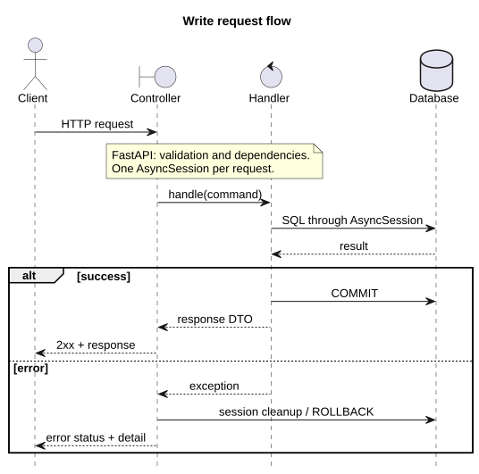

# API architecture

**Vertical Slice + CQRS:** one HTTP operation, one folder containing its complete implementation.

```text
app/
|-- features/<area>/<use_case>/
|   |-- controller.py     # HTTP endpoint
|   |-- request.py        # input validation
|   |-- command.py        # write operation; query.py for reads
|   |-- handler.py        # use case, SQL and transaction
|   `-- response.py       # HTTP output
|-- domain/               # domain models and rules
`-- infrastructure/       # database, ORM mappings and security
```

Create only the files an operation needs. Logout, for example, has no response DTO.

## Request flow



[PlantUML source](diagrams/request_transaction.puml)

## Rules

- Controllers instantiate handlers directly, create commands/queries and call handlers.
- Request DTOs use FastAPI body/query validation, including Pydantic validators; no request factories or `Depends`.
- Handlers use `AsyncSession` directly. No repository or mediator.
- One session per request. Write handlers call `await session.commit()`; closing the session rolls back unfinished transactions.
- Reads select the required columns without writing.
- Domain models import neither FastAPI nor SQLAlchemy. ORM tables and mappings live in `infrastructure/persistence`.
- Dependencies: `features -> infrastructure -> domain` and `features -> domain`.
- Each slice owns its input/output contracts.
- FastAPI `Depends` supplies infrastructure and authentication only (database session, security services, token and role checks). Handlers and request DTOs are never injected. The engine and cached security services are shared within a process.
- `app.py` registers routes, mappings and exception handlers. Database schema management stays outside the API.

Add a use case as a new folder and register its router.
[Authentication](../auth/README.md) | [Running the API](../../../services/api/README.md)
