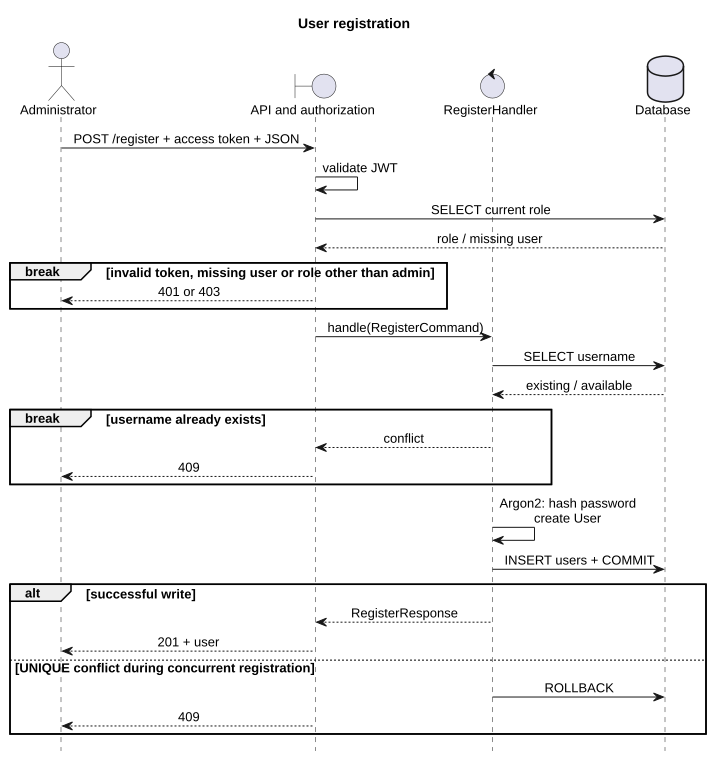
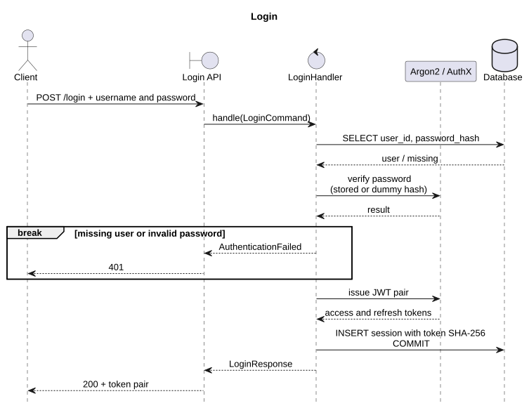

# Authentication

Base path: `/api/v1/auth`. Tokens use `Authorization: Bearer <token>`.

| Endpoint | Input / permission | Success |
| --- | --- | --- |
| `POST /register` | Admin access token; JSON: `username`, `password`, optional `role` | 201, user |
| `POST /login` | JSON: `username`, `password` | 200, token pair |
| `POST /refresh` | Refresh token | 200, new token pair |
| `POST /logout` | Refresh token | 204, empty body |
| `GET /me` | Access token | 200, current user |

Username: 1–128 characters without whitespace. Password: 12–1024 characters at registration,
1–1024 at login. Role: `user` (default) or `admin`. Extra JSON fields are rejected.

User response: `user_id`, `username`, `role`.
Token response: `access_token`, `refresh_token`, `token_type="bearer"`.

## Rules

- Passwords: Argon2. JWT: AuthX, HS256, `JWT_SECRET`; access expires after 15 minutes, refresh after 7 days.
- Admin permissions come from the current database role.
- Each login creates a session. Only the refresh token's SHA-256 hash is stored.
- Refresh deletes the old session and inserts its replacement atomically. Reusing the old token returns 401.
- Logout removes one refresh session; **the access token remains valid until expiry**.

First administrator, from `services/api`: `python -m app.infrastructure.bootstrap_admin`.
The command prompts for credentials and refuses creation if an administrator already exists.

## Sequence diagrams

[PlantUML sources](diagrams/)

## Errors

401: invalid authentication or inactive session. 403: admin required. 409: duplicate username.
422: invalid input. 503: database error. Errors use `detail`; 401 includes `WWW-Authenticate: Bearer`.

[Architecture](../architecture/README.md) · [Source code](../../../services/api/app/features/auth/)
