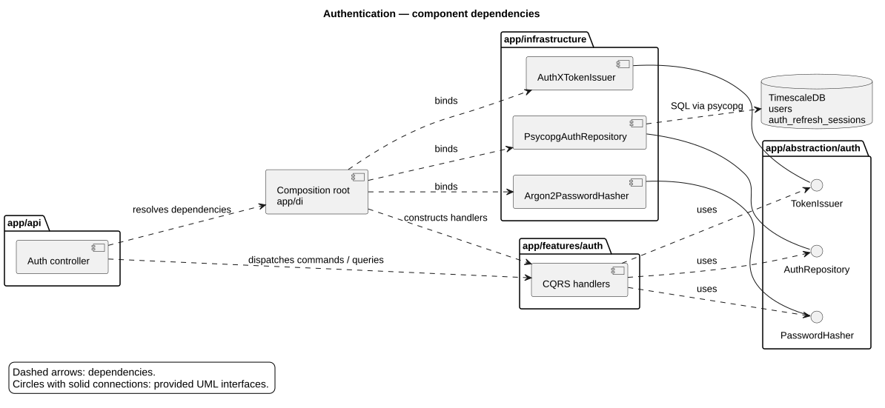
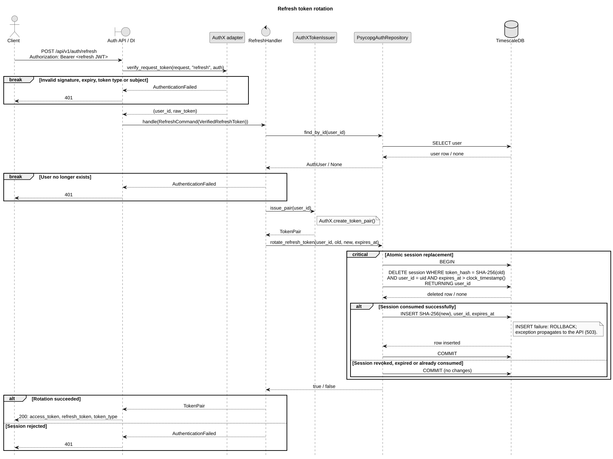

# Authentication and authorization

## Architecture

The API maps request DTOs to CQRS commands/queries. Handlers depend on Python protocols
in `app/abstraction/auth`; `app/di` binds them to infrastructure implementations through constructor injection.
`features` imports neither infrastructure nor FastAPI.

## HTTP contract

Base path: `/api/v1/auth`. JWT transport: `Authorization: Bearer <token>`.

| Method | Path | Input / authentication | Success |
| --- | --- | --- | --- |
| POST | `/register` | JSON: `username`, `password`, optional `role=user` | 201: `user_id`, `username`, `role` |
| POST | `/login` | JSON: `username`, `password` | 200: token pair |
| POST | `/refresh` | Refresh JWT | 200: new token pair |
| POST | `/logout` | Refresh JWT | 204 |
| GET | `/me` | Access JWT | 200: `user_id`, `username`, `role` |

Token pair: `access_token`, `refresh_token`, `token_type="bearer"`.
**Current behavior:** registration is public and accepts the requested role (`user` or `admin`).
`require_roles()` delegates to `ensure_role()` using the current database role, but is not attached to existing endpoints.

## Security and persistence

- AuthX: HS256, `JWT_SECRET`, access lifetime **15 minutes**, refresh lifetime **7 days**; signature, expiry and token-type validation.
- Passwords: `pwdlib` / Argon2id. Registration: username 1–128 non-whitespace characters; password 12–1024 characters.
- `users`: `user_id` PK, `username` UNIQUE, `password_hash`, `role`.
- `auth_refresh_sessions`: `token_hash` PK (SHA-256 of the JWT), `user_id` FK, `expires_at`, `created_at`.
- Rotation atomically deletes the old session and inserts its replacement. Concurrent reuse fails; insert failure rolls back deletion.
- Logout deletes the refresh session. Access tokens remain valid until expiry.

