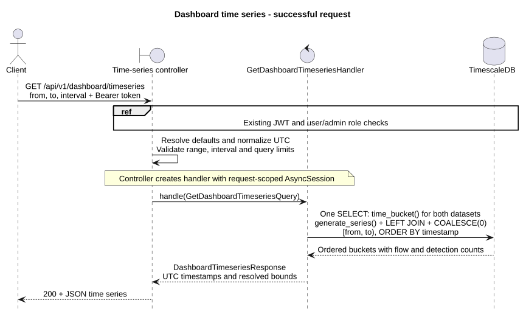

# Dashboard

Both endpoints require a Bearer access token for an existing `user` or `admin`.
Query timestamps must include a timezone; ranges are start-inclusive and end-exclusive.
Flows use `network_flows.ts_start`; detections and alerts use their own `created_at`.

## Summary

`GET /api/v1/dashboard/summary`

Required parameters: `start_time`, `end_time` (ISO 8601, `start_time < end_time`).
Returns independent row counts; all alert statuses count. Empty ranges return zeros.

```http
GET /api/v1/dashboard/summary?start_time=2026-10-20T00:00:00Z&end_time=2026-10-21T00:00:00Z
Authorization: Bearer <access_token>
```

```json
{"flow_count": 1200, "detection_count": 15, "alert_count": 3}
```

## Time series

`GET /api/v1/dashboard/timeseries`

| Parameter | Default | Meaning |
| --- | --- | --- |
| `from` | Resolved `to` minus 24 hours | Inclusive start, ISO 8601 |
| `to` | Now in UTC | Exclusive end, ISO 8601 |
| `interval` | `1h` | `5m`, `15m`, `1h` or `1d` |

Requires `from < to`; maximum 366 days and 2000 buckets, including partial buckets.
Returns UTC-aligned buckets in chronological order with zeros for missing data.
Partial buckets count only records in `[from, to)`; the first timestamp may precede
`from`. Response timestamps use UTC (`Z`).

```http
GET /api/v1/dashboard/timeseries?from=2026-10-20T00:00:00Z&to=2026-10-20T02:00:00Z&interval=1h
Authorization: Bearer <access_token>
```

```json
{
  "from": "2026-10-20T00:00:00Z",
  "to": "2026-10-20T02:00:00Z",
  "interval": "1h",
  "data": [
    {"timestamp": "2026-10-20T00:00:00Z", "flows_count": 1200, "detections_count": 15},
    {"timestamp": "2026-10-20T01:00:00Z", "flows_count": 0, "detections_count": 0}
  ]
}
```

## Implementation and errors




[PlantUML sources](diagrams/)

Controllers construct handlers directly. DI supplies authentication and a request-scoped
`AsyncSession`. Each handler executes one read-only statement: summary uses independent
`COUNT(*)` subqueries; time series uses `time_bucket()`, `generate_series()` and left joins.

Errors: `401` for failed authentication (`WWW-Authenticate: Bearer`), `422` for invalid
parameters or exceeded limits, `503` for database errors. Contracts: `/docs` and `/openapi.json`.

[Architecture](../architecture/README.md) | [Test setup](../../../services/api/tests/README.md)
