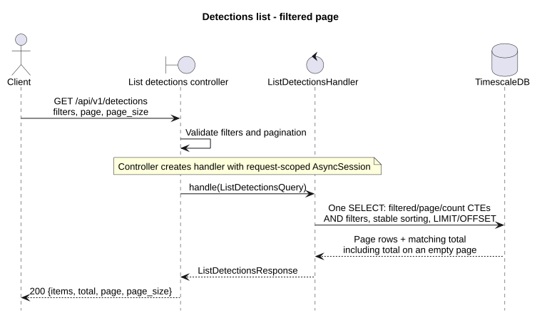
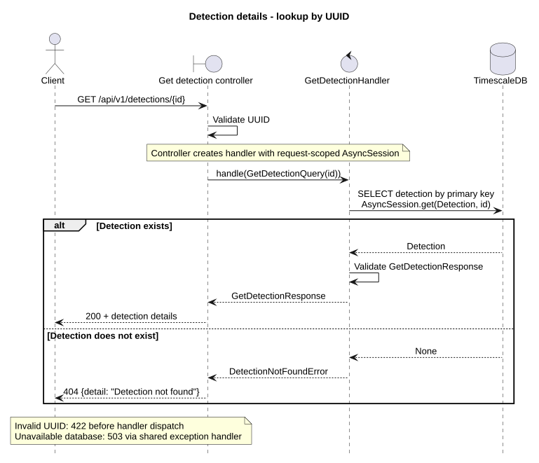

# Detections

## GET /api/v1/detections

Public endpoint returning a filtered page of detections. No token is required yet.

| Query parameter | Contract |
| --- | --- |
| `page` | Page number, starting at 1; default 1. |
| `page_size` | 1–500 items; default 50. |
| `limit` | Deprecated alias for `page_size`; values must match when both are supplied. |
| `start_time`, `end_time` | Optional ISO 8601 timestamps with timezones; filter `created_at` in `[start_time, end_time)`. Start must precede end. |
| `severity` | `LOW`, `MEDIUM`, `HIGH`, or `CRITICAL`. |
| `detection_type`, `method`, `protocol` | Exact, case-sensitive matches. |
| `src_ip`, `dst_ip` | Exact IPv4 or IPv6 address matches. |
| `sort_order` | `asc` or `desc` (default); order by `created_at`, then `detection_id` in the same direction. |

Filters combine with AND. Example: `GET /api/v1/detections?severity=HIGH&page=2&page_size=25`.

Response: `{"items": [...], "total": 81, "page": 2, "page_size": 25}`.
`total` counts all matching rows before pagination. An empty or out-of-range page
returns `items: []` with the correct total. Items retain the existing detection fields,
including type, method, severity, confidence, IPs, window size, features and explanation.
Each item also includes `first_ingested_at` and `last_ingested_at`, returned as stored
ISO 8601 timestamps with timezones, or `null` when unavailable.
Consumers of the former array response must now read `items`.

The controller validates query parameters, maps them to `ListDetectionsQuery`,
and calls `ListDetectionsHandler`. A single SQL statement uses filtered/page/count
CTEs and an outer join so items and total share one database snapshot. Offset
pagination can shift between requests when concurrent detections arrive.
Invalid input returns `422`; unavailable storage returns `503`.

[PlantUML source](diagrams/list_detections_sequence.puml)

Tests: `services/api/tests/integration/test_list_detections.py` covers filters,
time boundaries, stable pages, empty results, aliases and invalid input using
real HTTP and TimescaleDB. Existing compatibility, dashboard and full-stack tests
also consume the paginated response.

## GET /api/v1/detections/{id}

Public lookup by detection UUID; no token is required yet. Returns one JSON object
with `detection_id`, `configuration_id`, `created_at`, `type`, `method`, `severity`,
`confidence`, `first_ingested_at`, `last_ingested_at`, source/destination IPs and
ports, `protocol`, `window_size_s`, `window_start`, `window_end`, `features`,
`explanation` and `trace_ids`.
Timestamps use ISO 8601 with timezones. Optional evidence remains `null` when
unavailable; `trace_ids` is an array, including `[]` when empty.

The controller validates `id`, creates `GetDetectionQuery` and calls
`GetDetectionHandler`. The handler uses `AsyncSession.get(Detection, id)` and
serializes the mapped entity as `GetDetectionResponse`. Reads do not modify rows
or require an associated alert or configuration. `last_ingested_at` already exists
in the database; its domain and ORM mappings are included in this implementation.

| Status | Meaning |
| --- | --- |
| `200` | Detection found. |
| `404` | Valid UUID without a detection: `{"detail": "Detection not found"}`. |
| `422` | Invalid UUID; validation error points to `path.id`. |
| `503` | Storage unavailable: `{"detail": "Database storage unavailable"}`. |

[PlantUML source](diagrams/get_detection_sequence.puml)

Tests: `services/api/tests/integration/test_get_detection.py` exercises the real
HTTP/ORM/database path: complete evidence and read-only lookup, nullable fields,
independent ingestion timestamps, missing records, invalid UUIDs, a real database
connection refusal and the OpenAPI contract. It uses the existing disposable
TimescaleDB fixtures and no mocks or dependency overrides.
