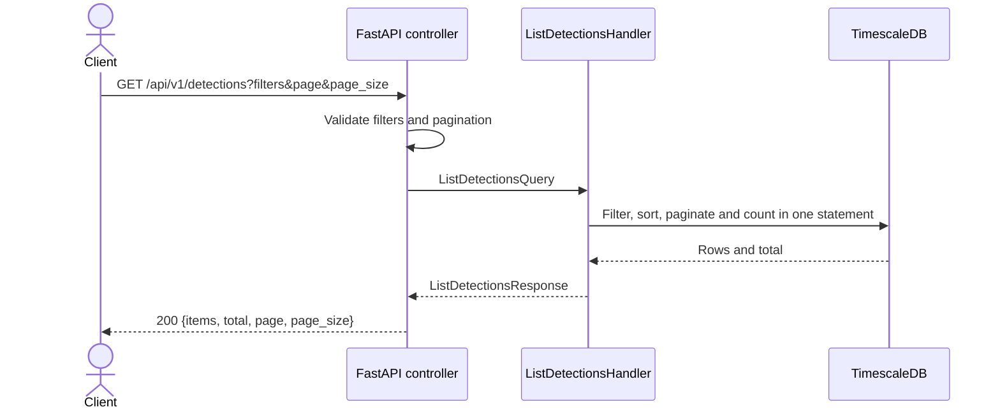

# Detections

## GET /api/v1/detections

Public endpoint returning a filtered page of detections. No token is required yet.

| Query parameter | Contract |
| --- | --- |
| `page` | Page number, starting at 1; default 1. |
| `page_size` | 1–500 items; default 50. |
| `limit` | Deprecated alias for `page_size`; values must match when both are supplied. |
| `start_time`, `end_time` | Optional ISO 8601 timestamps with timezones; filter `created_at` in `[start_time, end_time)`. Start must precede end. |
| `severity` | `LOW`, `MEDIUM`, `HIGH`, or `CRITICAL`. |
| `detection_type`, `method`, `protocol` | Exact, case-sensitive matches. |
| `src_ip`, `dst_ip` | Exact IPv4 or IPv6 address matches. |
| `sort_order` | `asc` or `desc` (default); order by `created_at`, then `detection_id` in the same direction. |

Filters combine with AND. Example: `GET /api/v1/detections?severity=HIGH&page=2&page_size=25`.

Response: `{"items": [...], "total": 81, "page": 2, "page_size": 25}`.
`total` counts all matching rows before pagination. An empty or out-of-range page
returns `items: []` with the correct total. Items retain the existing detection fields,
including type, method, severity, confidence, IPs, window size, features and explanation.
Consumers of the former array response must now read `items`.

The controller validates query parameters, maps them to `ListDetectionsQuery`,
and calls `ListDetectionsHandler`. A single SQL statement uses filtered/page/count
CTEs and an outer join so items and total share one database snapshot. Offset
pagination can shift between requests when concurrent detections arrive.
Invalid input returns `422`; unavailable storage returns `503`.

Tests: `services/api/tests/integration/test_list_detections.py` covers filters,
time boundaries, stable pages, empty results, aliases and invalid input using
real HTTP and TimescaleDB. Existing compatibility, dashboard and full-stack tests
also consume the paginated response.
