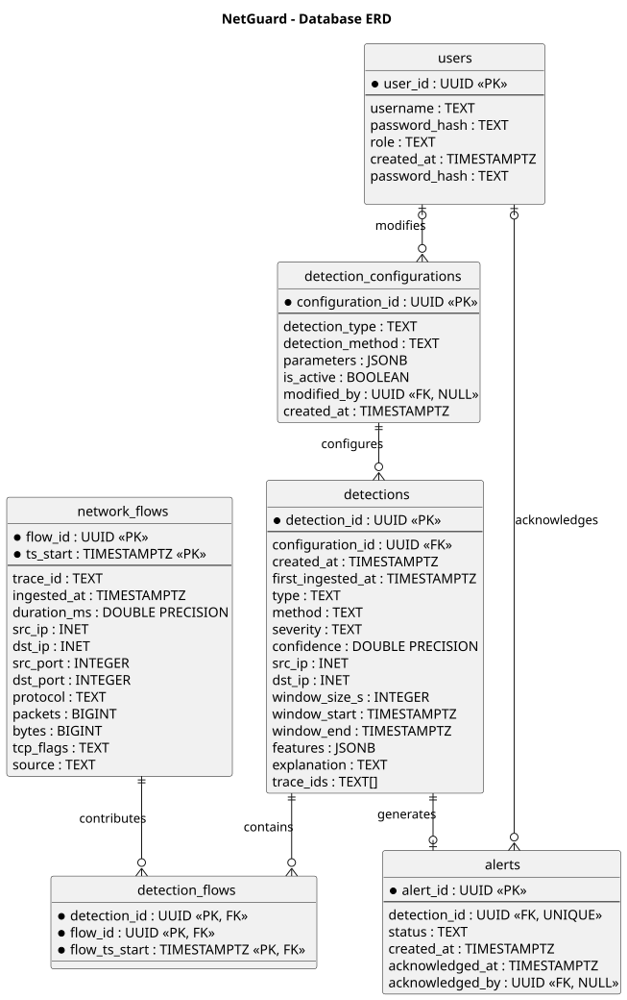

# NetGuard - Database Model

## Overview

The database model is designed to store network traffic, detection results, alerts, detection configurations, and user information.

It uses PostgreSQL with TimescaleDB to support efficient storage and querying of time-series network data.

## Design Decisions

- **Network Flows** - Stores normalized network traffic. TimescaleDB hypertable partitioning by `ts_start` supports efficient queries and storage of large traffic volumes (F02, F10, NFR01).

- **Detections** - Stores detected anomalies, including their classification, severity, confidence, and supporting features (F08, F09).

- **Detection Flows** - Implements the many-to-many relationship between flows and detections. A detection may involve multiple flows, and a single flow may contribute to multiple detections. This supports traceability (F15).

- **Alerts** - Separates anomaly detection from operator interaction, allowing alerts to be acknowledged and their status tracked (F17).

- **Detection Configurations** - Stores configurable detection parameters as JSONB, supporting different detection methods without requiring separate database structures (F10, F16).

- **Users** - Stores user identities and roles required for authentication, authorization, and alert acknowledgement (NFR06, F17).

## Key Relationships

| Relationship | Cardinality | Purpose |
|---|---|---|
| Network Flows - Detections | M:N | Identify flows contributing to detections |
| Detections - Alerts | 1:0..1 | Generate alerts from detected anomalies |
| Detection Configurations - Detections | 1:N | Associate detections with their configurations |
| Users - Alerts | 1:N | Track alert acknowledgements |
| Users - Detection Configurations | 1:N | Track configuration modifications |

