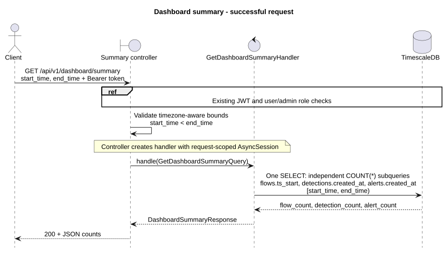

# Dashboard

Both endpoints require a Bearer access token for an existing `user` or `admin`.
Query timestamps must include a timezone; ranges are start-inclusive and end-exclusive.
Flows use `network_flows.ts_start`; detections and alerts use their own `created_at`.

## Summary

`GET /api/v1/dashboard/summary`

Required parameters: `start_time`, `end_time` (ISO 8601, `start_time < end_time`).
Returns independent row counts; all alert statuses count. Empty ranges return zeros.

```http
GET /api/v1/dashboard/summary?start_time=2026-10-20T00:00:00Z&end_time=2026-10-21T00:00:00Z
Authorization: Bearer <access_token>
```

```json
{"flow_count": 1200, "detection_count": 15, "alert_count": 3}
```

## Time series

`GET /api/v1/dashboard/timeseries` matches the dashboard contract: query parameters
`start_time`, `end_time` (timezone-aware ISO 8601) and `interval_s` (whole seconds,
1-86400). The default end is now in UTC; the default start is 24 hours before the
resolved end, and the default interval is 3600 seconds. The start is inclusive
and the end exclusive. Ranges must be positive, at most 366 days, and intersect
at most 500 buckets, including partial buckets. Invalid queries return `422`.

```http
GET /api/v1/dashboard/timeseries?start_time=2026-10-20T12:00:00Z&end_time=2026-10-20T12:15:00Z&interval_s=60
Authorization: Bearer <access_token>
```

Response shape (one example point shown):

```json
{
  "interval_s": 60,
  "points": [
    {
      "ts": "2026-10-20T12:00:00Z",
      "flows": 12034,
      "packets": 401223,
      "bytes": 88123456,
      "detections": {"LOW": 1, "MEDIUM": 0, "HIGH": 2, "CRITICAL": 0}
    }
  ]
}
```

Points are ordered by `ts`, aligned to Unix epoch in UTC, with empty buckets
filled with zeros. The first bucket may begin before `start_time`; partial
buckets only count records inside `[start_time, end_time)`. Flow counts and
packet/byte sums use `network_flows.ts_start`; detection counts use
`detections.created_at` and include all four severity levels. Missing packet
or byte values contribute zero. Timestamps are serialized with `Z`.
The UI can use 5, 15, 60 and 900 seconds for its 5 min, 15 min, 1 h and 24 h views.

## Implementation and errors




[PlantUML sources](diagrams/)

Controllers construct handlers directly. DI supplies authentication and a request-scoped
`AsyncSession`. Each handler executes one read-only statement: summary uses independent
`COUNT(*)` subqueries; time series uses `time_bucket()`, `generate_series()` and left joins.

Errors: `401` for failed authentication (`WWW-Authenticate: Bearer`), `422` for invalid
parameters or exceeded limits, `503` for database errors. Contracts: `/docs` and `/openapi.json`.

[Architecture](../architecture/README.md) | [Test setup](../../../services/api/tests/README.md)
