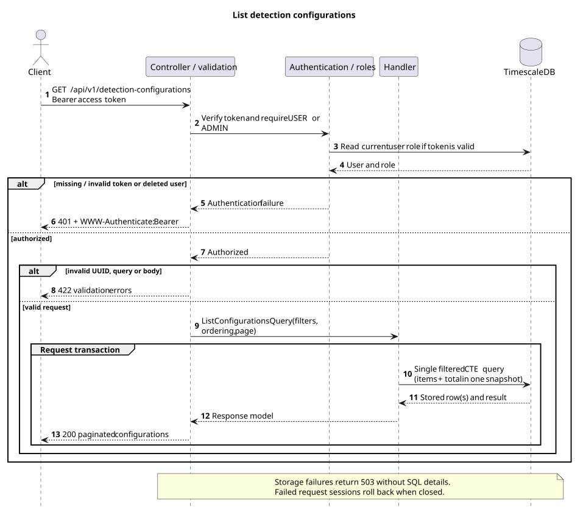
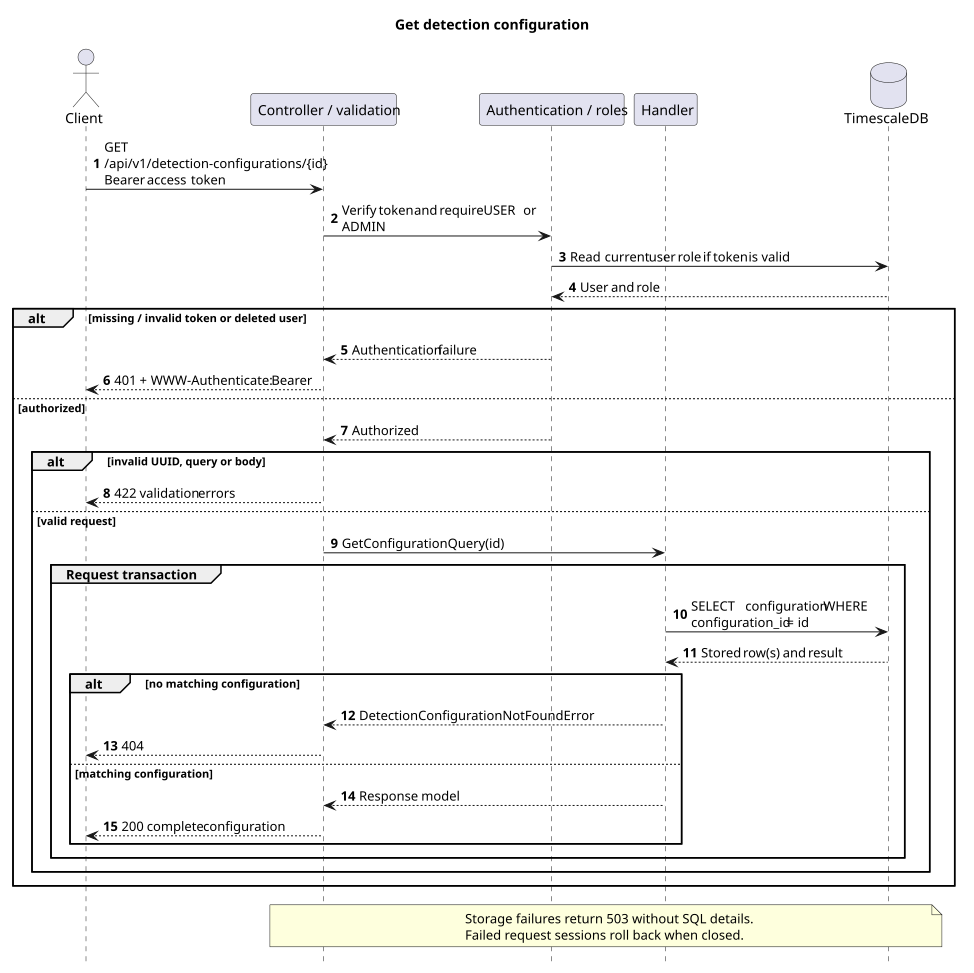
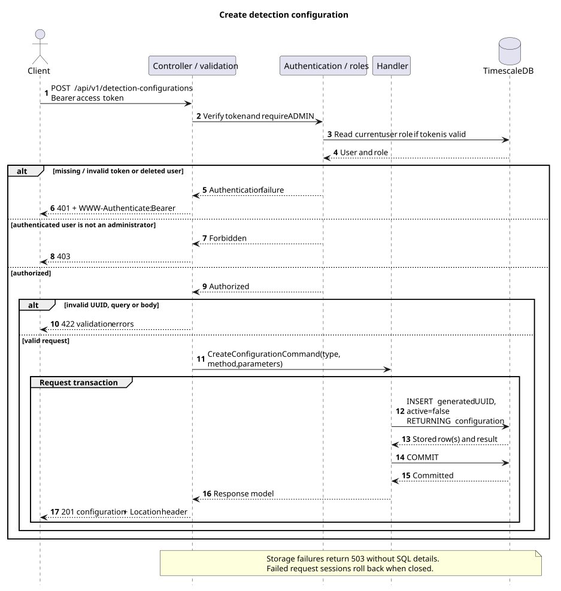
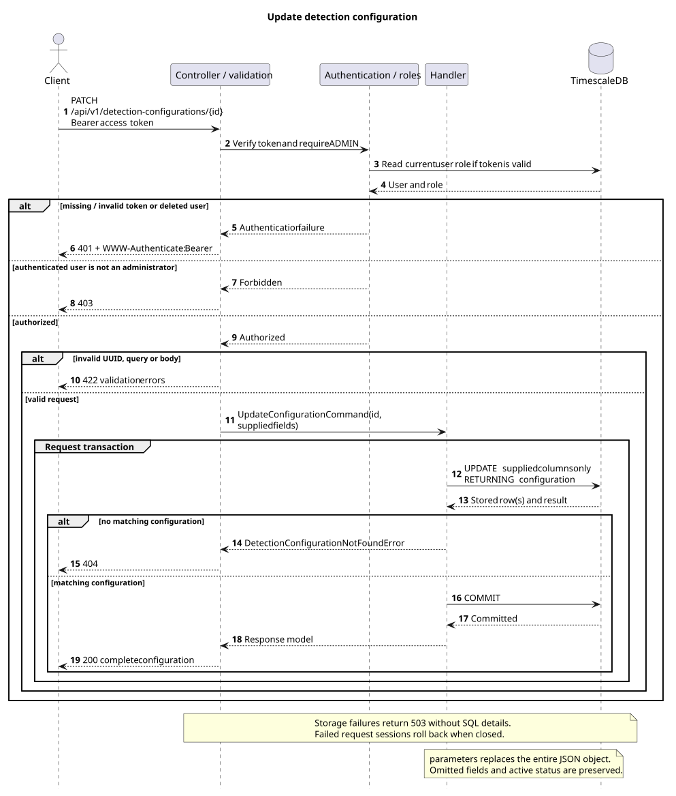
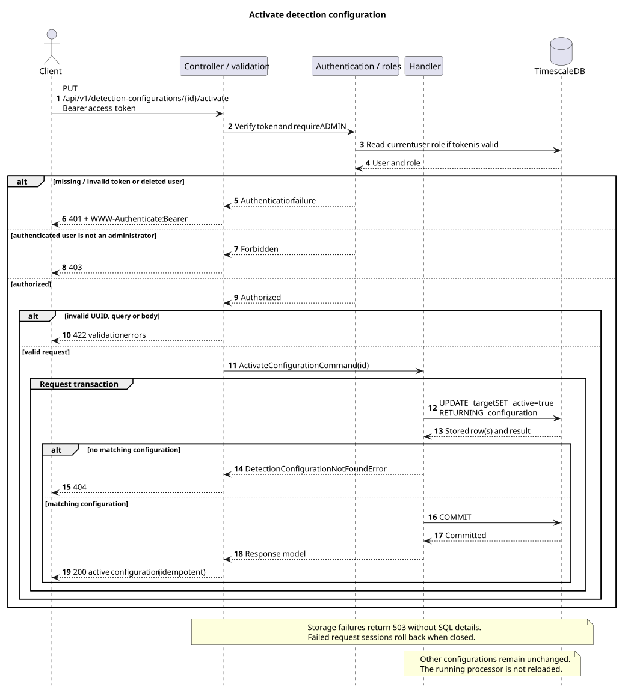

# Detection configurations

Implements [issue #48](https://github.com/k1borg32/Netguard/issues/48) using the
existing `detection_configs` table. All endpoints require a Bearer **access** token
and an existing user. Both `USER` and `ADMIN` can read; only `ADMIN` can write.
Missing, invalid, refresh or deleted-user tokens return `401` with
`WWW-Authenticate: Bearer`. A regular user's write returns `403`.

## Configuration representation

All detail and write responses contain the same five fields:

```json
{
  "configuration_id": "10000000-0000-0000-0000-000000000001",
  "detection_type": "port_scan",
  "method": "rule",
  "parameters": {"window_s": 10, "unique_dst_ports_threshold": 100},
  "active": false
}
```

`configuration_id` is a server-generated UUID. `detection_type` and `method` are
case-sensitive strings, trimmed on input and restricted to 1-128 characters.
They are not closed enums: definitions for additional algorithms can be stored.
`parameters` must be a JSON object; nested objects, arrays, booleans, numbers,
strings and nested nulls retain their JSON types. An empty object is valid.
Non-finite numbers, null characters and unpaired Unicode surrogates are rejected
before SQL execution. Algorithm-specific parameter names and thresholds are not
validated because the physical schema defines `parameters` as free JSONB.

## GET /api/v1/detection-configurations

Returns `200` with `items`, `total`, `page`, `page_size`, `total_pages`, `has_next`
and `has_previous`. Each item has the representation above.

| Query parameter | Default | Contract |
| --- | --- | --- |
| `detection_type` | omitted | Exact, case-sensitive match; 1-128 characters after trimming |
| `method` | omitted | Exact, case-sensitive match; 1-128 characters after trimming |
| `active` | omitted | Boolean; `false` filters inactive configurations |
| `sort_order` | `asc` | `asc` or `desc`, ordered by unique `configuration_id` |
| `page` | `1` | Integer, at least 1 |
| `page_size` | `50` | Integer, 1-100 |

Filters combine with AND. Items and the filtered total come from a single SQL
statement and snapshot. Empty and out-of-range pages retain the correct total.
`total_pages` is zero for no matches; `has_previous` is false for an empty result.
Reads do not update configurations. Invalid query parameters return `422`.

Example: `GET /api/v1/detection-configurations?detection_type=port_scan&active=false&page_size=20`.


[PlantUML source](diagrams/list_configurations_sequence.puml)

## GET /api/v1/detection-configurations/{id}

Returns `200` with the complete stored configuration. The UUID identifies one
row regardless of its active state or whether any detections reference it.
An unknown UUID returns `404` with
`{"detail":"Detection configuration not found"}`. An invalid UUID returns `422`.
This operation does not modify configuration or detection rows.


[PlantUML source](diagrams/get_configuration_sequence.puml)

## POST /api/v1/detection-configurations

Administrator only. All three fields are required:

```json
{
  "detection_type": "port_scan",
  "method": "rule",
  "parameters": {"window_s": 10, "unique_dst_ports_threshold": 100}
}
```

Returns `201` with the complete committed configuration and a `Location` header
pointing to `/api/v1/detection-configurations/{configuration_id}`. The server
generates the UUID and creates the configuration with `active=false`.
Separate configurations may share the same detection type and method.

Client-supplied `configuration_id`, `active`, unknown fields, missing fields and
invalid values return `422`. Use the activation endpoint to enable a definition.


[PlantUML source](diagrams/create_configuration_sequence.puml)

## PATCH /api/v1/detection-configurations/{id}

Administrator only. Provide at least one of `detection_type`, `method` or
`parameters`. Omitted fields retain their values. A supplied `parameters` object
**replaces the entire stored object**; nested keys are not merged.

```json
{"parameters": {"window_s": 60, "unique_dst_ports_threshold": 250}}
```

`{"parameters":{}}` clears the object. An empty body, explicit null, invalid
values, unknown fields, `active` and `configuration_id` return `422`.
Activation state is preserved even if a concurrent activation commits.

Returns `200` with the complete committed configuration. An unknown UUID returns
`404`; an invalid UUID returns `422`. Only supplied columns of the target row are
updated; other definitions and detections are unchanged.


[PlantUML source](diagrams/update_configuration_sequence.puml)

## PUT /api/v1/detection-configurations/{id}/activate

Administrator only. No request body. Atomically sets the target row's `active`
flag to `true`, commits, and returns `200` with the complete configuration.
Repeated or concurrent activation is idempotent. It does not reset parameters
or deactivate other rows: the current domain and schema allow multiple enabled
configurations. An unknown UUID returns `404`; an invalid UUID returns `422`.


[PlantUML source](diagrams/activate_configuration_sequence.puml)

## Persistence and runtime scope

Controllers construct their handlers directly. Authentication and the
request-scoped `AsyncSession` are dependencies; handlers execute SQL against the
existing table. Writes use `INSERT/UPDATE ... RETURNING` and commit before
returning success. Closing a failed request session rolls back its transaction.
No schema migration is required. Storage errors return `503` with
`{"detail":"Database storage unavailable"}`, without SQL or connection details.

These endpoints manage **stored definitions**. The current processor reads
`config/detection.yaml` at startup and does not consume this table or reload after
an API update. Database activation alone therefore does not change the running
detector. Processor integration and a deactivation operation are outside these
five endpoint contracts.

## Verification

[HTTP integration tests](../../../services/api/tests/integration/test_detection_configurations.py)
use the real application, JWT authentication and a disposable TimescaleDB.
They cover read permissions, admin-only writes, invalid/deleted-user tokens,
stable pagination, filtered totals, nested JSON, persistence, replacement edits,
missing IDs, validation, concurrent activation/editing, OpenAPI and real storage
errors. No mocks or dependency overrides are used.

[Request tests](../../../services/api/tests/unit/test_detection_configuration_requests.py)
cover required fields, nulls, invalid identifiers, JSONB-compatible values,
unknown fields, partial updates and pagination bounds.

[Endpoint plan](../endpoints.md) · [Test setup](../../../services/api/tests/README.md)
