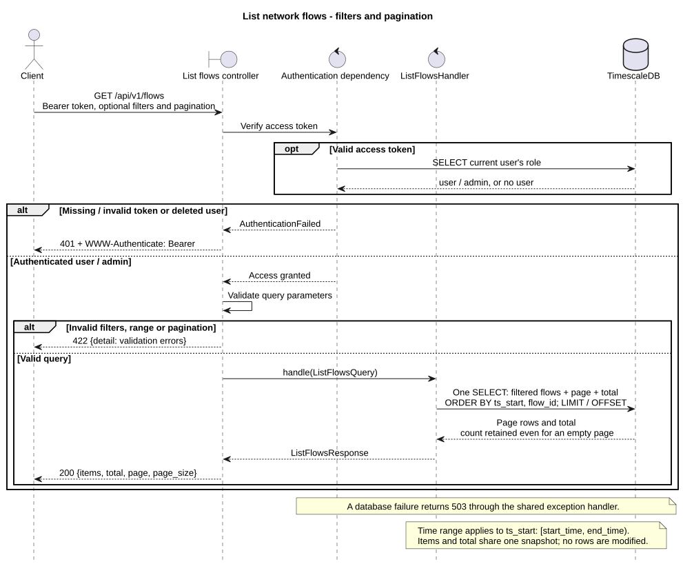
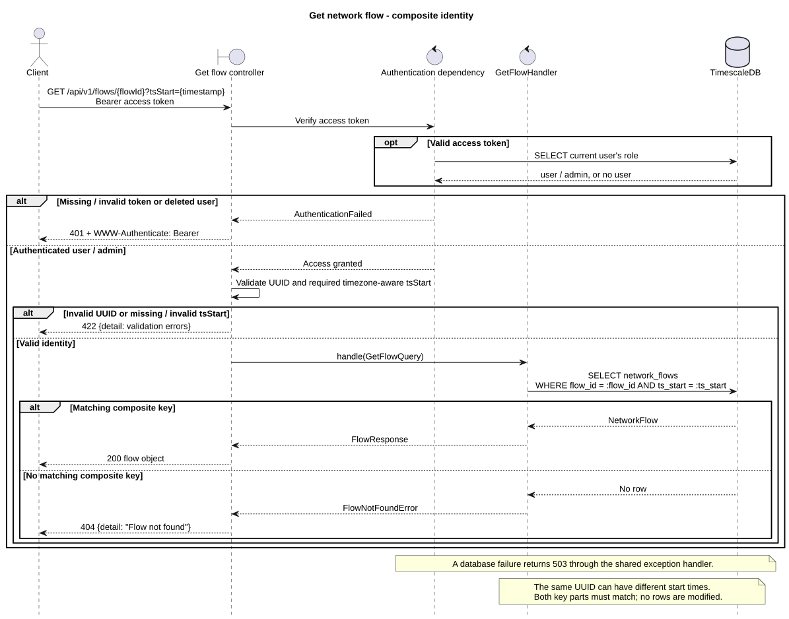

# Network flows

Both endpoints require a Bearer access token belonging to an existing `user` or
`admin`. They read stored network flows without modifying records. A flow is
identified by the composite key `(flow_id, ts_start)`: the same UUID can occur
at different start times.

## List

`GET /api/v1/flows` returns `200 OK` with:

```json
{
  "items": [
    {
      "flow_id": "00000000-0000-0000-0000-000000000001",
      "ts_start": "2026-01-01T12:00:00Z",
      "trace_id": "trace-001",
      "ingested_at": "2026-01-01T12:00:01Z",
      "duration_ms": 12.5,
      "src_ip": "192.0.2.1",
      "dst_ip": "198.51.100.2",
      "src_port": 12345,
      "dst_port": 443,
      "protocol": "TCP",
      "packets": 7,
      "bytes": 1024,
      "tcp_flags": "S",
      "source": "simulator",
      "label": "benign"
    }
  ],
  "total": 1,
  "page": 1,
  "page_size": 50
}
```

All query parameters are optional:

| Parameter | Meaning / default |
| --- | --- |
| `start_time` | Inclusive lower bound on `ts_start`, ISO 8601 with timezone |
| `end_time` | Exclusive upper bound on `ts_start`, ISO 8601 with timezone |
| `src_ip`, `dst_ip` | Exact IPv4 or IPv6 host addresses; CIDR filters are unsupported |
| `src_port`, `dst_port` | Exact port numbers in `0..65535` |
| `protocol` | Nonempty, exact, case-sensitive match, e.g. `TCP` |
| `sort_order` | `desc` (default) or `asc`, applied to `ts_start`, then `flow_id` in the same direction |
| `page` | One-based page number, default `1` |
| `page_size` | `1..100`, default `50` |

Filters combine with AND. The time range is `[start_time, end_time)`; when both
bounds are supplied, `start_time < end_time` is required. Different timezone
offsets are compared as instants. Either bound can be used alone; no bounds
means all stored start times. IP addresses are normalized, so equivalent IPv6
spellings match. Encode `+` as `%2B` in timestamps written directly in a URL.

`total` counts all matching flows before pagination. Empty results and pages
beyond the last page return `items: []`, retaining the matching total and the
requested page. Items and total are read in one SQL statement and share a
database snapshot. The composite key gives deterministic ordering, including
UUIDs repeated at different start times. Offset pagination can still shift
between requests when matching records are inserted or removed.

Example:

```http
GET /api/v1/flows?start_time=2026-01-01T00:00:00Z&end_time=2026-01-02T00:00:00Z&protocol=TCP&dst_port=443&sort_order=desc&page=1&page_size=20
Authorization: Bearer <access_token>
```

To fetch the next page, retain the filters, ordering and `page_size` and send
`page=2`. The controller maps validated parameters to `ListFlowsQuery` and
constructs `ListFlowsHandler`. Its SQL uses filtered/page/count CTEs and an outer
join to preserve the count for an empty page.



[PlantUML source](diagrams/list_flows_sequence.puml)

## Details

`GET /api/v1/flows/{flowId}?tsStart={timestamp}` returns `200 OK` with a single
flow object, containing the same fields as a list item above.

| Parameter | Meaning |
| --- | --- |
| `flowId` | Required path UUID, corresponding to `flow_id` |
| `tsStart` | Required query timestamp with timezone, corresponding to `ts_start`; the parameter name is case-sensitive |

Both parts must match an existing row. Equivalent timezone offsets identify the
same instant; timestamp precision is preserved. A UUID with a different start
time identifies a different flow. The list's `flow_id` and `ts_start` values can
be used directly for this lookup, with the query parameter named `tsStart`.

```http
GET /api/v1/flows/00000000-0000-0000-0000-000000000001?tsStart=2026-01-01T12:00:00Z
Authorization: Bearer <access_token>
```

| Flow fields | Contents |
| --- | --- |
| `flow_id`, `ts_start` | Composite identity: UUID and start timestamp |
| `trace_id`, `ingested_at` | Optional trace identifier and ingestion timestamp |
| `duration_ms` | Optional duration in milliseconds |
| `src_ip`, `dst_ip`, `src_port`, `dst_port`, `protocol` | Optional network endpoints and protocol |
| `packets`, `bytes`, `tcp_flags` | Optional packet count, byte count and TCP flags |
| `source`, `label` | Optional producer/source and ground-truth label |

All fields are included. Values other than the composite key may be `null`.
Timestamps use ISO 8601 with timezones; IP addresses are strings. No related
detection is required. The controller constructs `GetFlowQuery` and
`GetFlowHandler`; the handler retrieves the mapped `NetworkFlow` using
`AsyncSession.get(NetworkFlow, (flow_id, ts_start))` and returns `FlowResponse`.



[PlantUML source](diagrams/get_flow_sequence.puml)

## Errors and implementation

| Status | Cause |
| --- | --- |
| `401` | Missing, invalid or expired access token, refresh token, or deleted user; includes `WWW-Authenticate: Bearer` |
| `404` | No stored flow matches both identity values for details; `{"detail": "Flow not found"}` |
| `422` | Invalid filter, time range, pagination, path UUID, or missing/invalid `tsStart`; `{"detail": [...]}` |
| `503` | Database operation failed; `{"detail": "Database storage unavailable"}` |

Validation errors identify the invalid query or path field, such as
`["query", "end_time"]`, `["query", "tsStart"]` or `["path", "flowId"]`.
A timestamp without a timezone is invalid. These GET operations take parameters
from the URL, not a request body.

The implementation follows one operation per folder under
`services/api/app/features/flows/`: controller, query, handler and response, with
list validation in its request model and a shared `FlowResponse`. Controllers
construct handlers directly; dependencies provide authentication and the
request-scoped database session. Existing schema and imperative ORM mappings
are reused without migrations. OpenAPI is available at `/docs`.

[Integration tests](../../../services/api/tests/integration/test_flows.py)
cover both roles, authentication failures, individual and combined filters,
IPv6 normalization, time boundaries, deterministic pages, repeated UUIDs,
empty pages and totals, complete and nullable fields, composite lookup,
validation and OpenAPI using real HTTP and disposable TimescaleDB.
[Unit tests](../../../services/api/tests/unit/test_list_flows_request.py)
cover optional filters, port and pagination bounds, invalid IP addresses and
timezone-aware range comparisons. No mocks or dependency overrides are used.

[Endpoint plan](../endpoints.md) · [Test setup](../../../services/api/tests/README.md)
