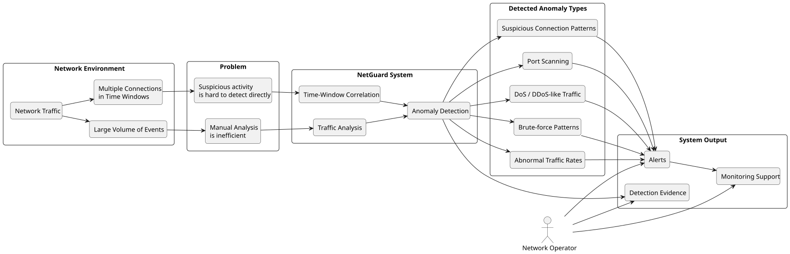
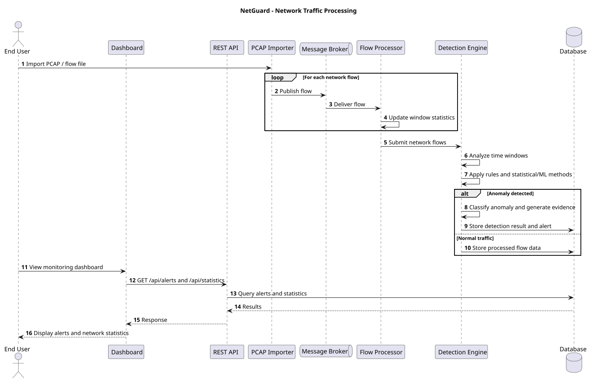
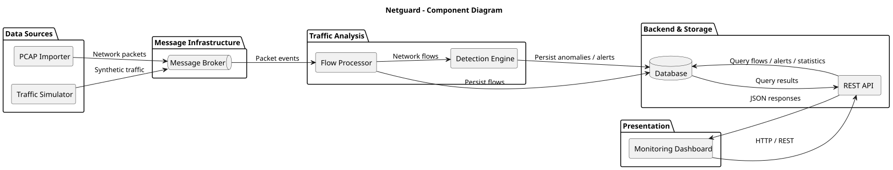

# NetGuard - Vision Document v1.0

## 1. Introduction and Document Purpose

NetGuard is a network traffic analysis platform designed to detect, classify, and report anomalous network behavior.

This document defines the project scope, system requirements, use cases, constraints, and validation criteria.

## 2. Problem and Context

Network traffic generates large volumes of events that cannot be efficiently analyzed manually. Suspicious activity often requires analysis of multiple connections within defined time windows.

The system addresses the detection of:

- Port scanning
- DoS/DDoS-like traffic
- Brute-force patterns
- Abnormal traffic rates
- Suspicious connection patterns

Problem-context diagram

## 3. System Goal and Expected Benefits

**Goal:** Implement a system for automated network traffic anomaly detection using rule-based and statistical or machine learning methods.

**Expected results:**

- Automated processing of network traffic data.
- Detection and classification of anomalies.
- Generation of alerts with supporting evidence.
- Historical data storage and retrieval.
- Visualization of network activity and detection results.
- Measurement of detection accuracy and processing performance.

## 4. Users and Stakeholders

| Role | Responsibility |
|---|---|
| End User | Monitors network traffic, views detected anomalies, and analyzes alerts. |
| Project Supervisor | Oversees the development team and monitors project progress. |
| Development Team | Designs, implements, tests, and delivers the system. |

## 5. Use Cases

| ID | Use Case | Role |
|---|---|---|
| UC-01 | Import PCAP files | End User |
| UC-02 | View detected anomalies and alerts | End User |
| UC-03 | View detection evidence and details | End User |
| UC-04 | Browse historical detections | End User |
| UC-05 | Filter alerts by type, severity and time | End User |
| UC-06 | View network traffic statistics | End User |
| UC-07 | Configure detection thresholds | End User |
| UC-08 | View network flow details | End User |
| UC-09 | Acknowledge an alert | End User |
| UC-10 | Generate synthetic network traffic | Developer |
| UC-11 | Configure traffic simulation parameters | Developer |
| UC-12 | Start traffic simulation | Developer |
| UC-13 | Stop traffic simulation | Developer |

## 6. Product Function Overview

**Processing pipeline:**

`PCAP / Simulator → Flow Processing → Detection Engine → Storage / API → Dashboard`

**Core components:**

- PCAP Importer
- Traffic Simulator
- Flow Processor
- Detection Engine
- Alert Management
- Database
- REST API
- Monitoring Dashboard

## 7. Requirements

### 7.1 Functional Requirements

| ID | Area | Requirement |
|---|---|---|
| F01 | Data ingestion | Import prepared PCAP/flow data and validate input. |
| F02 | Flow extraction | Convert traffic into a normalised flow model. |
| F03 | Feature extraction | Calculate temporal, volume, and connection-related features. |
| F04 | Stream processing | Process data continuously using inter-component communication. |
| F05 | Time windows | Analyse using at least 1 s, 10 s, and 60 s windows. |
| F06 | Rule-based detection | Detect Port Scan, DoS-like, Brute Force-like, and Abnormal Connection Pattern. |
| F07 | Second detection method | Implement a statistical or ML-based method, e.g. z-score, moving statistics, Isolation Forest, or equivalent. |
| F08 | Classification | Store type, severity, confidence, timestamp, source, destination, and detection ID. |
| F09 | Explainability | Provide evidence and feature values explaining the alert. |
| F10 | Database | Persist flows, detections, configuration, and historical data. |
| F11 | REST API | Expose current data, history, statistics, and alerts. |
| F12 | Dashboard | Provide traffic monitoring, alerts, statistics, and detection details. |
| F13 | Filtering | Filter history by at least time, type, severity, and source. |
| F14 | Simulator | Generate normal traffic and four predefined anomalous scenarios. |
| F15 | Traceability | Allow an event to be traced from input to the generated detection. |

### 7.2 Non-Functional Requirements

| ID | Category | Requirement |
|---|---|---|
| NFR01 | Performance | Process at least 5,000 flows/s for a minimum of 5 minutes. |
| NFR02 | Latency | At 5,000 flows/s, p95 from data acceptance to detection creation must not exceed 3 s in the nominal failure-free scenario. |
| NFR03 | Scalability | At least one processing component must support more than one instance. |
| NFR04 | Resilience | Restart/failure of one processing instance must not stop the entire platform. |
| NFR05 | Reproducibility | The complete system must be deployable using one documented procedure. |
| NFR06 | Security | The API must provide authentication, authorisation for administrative operations, input validation, and basic API-abuse protection. |
| NFR07 | Testability | Key components must have unit and integration tests. |
| NFR08 | Observability | Logs must support tracing data flow and diagnosing failures. |
| NFR09 | Data | No dependency on production data or real networks. |
| NFR10 | Documentation | The repository must contain deployment, configuration, testing, and demonstration instructions. |

## 8. Assumptions, Constraints and Dependencies

**Assumptions:**

- Input consists of prepared PCAP datasets and synthetic traffic.
- Detection methods operate on network flow features.
- Test datasets contain identifiable normal and anomalous traffic.

**Constraints:**

- Five-person development team.
- Ten-week development period.
- No unauthorized monitoring of external networks.
- No development of real-world attack tools.
- Commercial SIEM/IDS functionality is out of scope.

**Dependencies:**

- Availability of suitable network traffic datasets.
- Defined network flow and detection result contracts.
- Integration between processing, detection, storage, and visualization components.

## 9. Test Data and Demonstration Environment

**Test data:**

- Normal network traffic.
- Port scanning scenarios.
- DoS/DDoS-like traffic.
- Brute-force patterns.
- Abnormal traffic rates.
- Synthetic load-testing datasets.

**Demonstration:**

- Import a prepared PCAP file or start traffic simulation.
- Process network flows and execute anomaly detection.
- Store generated alerts.
- Display alerts, evidence, and traffic statistics.
- Present detection quality and performance measurements.

**Environment:** Reproducible, isolated deployment using documented configuration.